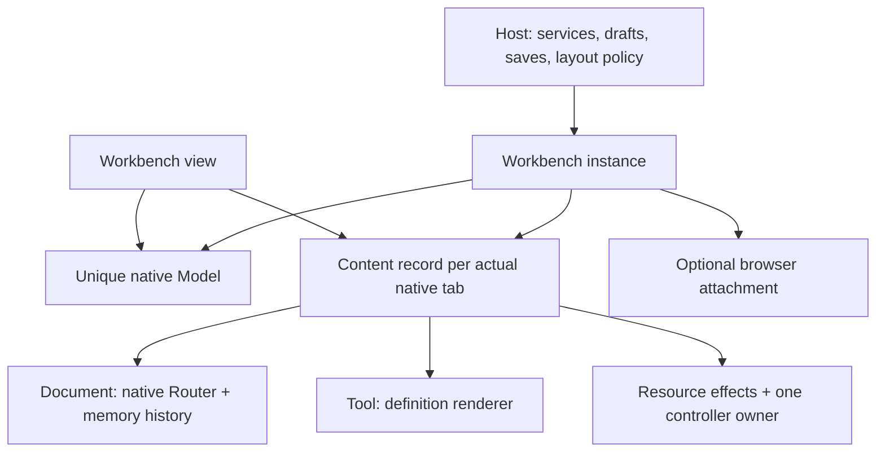

# Architecture

Worksplit adds coordination where native primitives do not know about each other. FlexLayout's
Model owns the layout, TanStack Router/history owns each document's accepted navigation, and
one content record owns that tab's lifetime. No second layout tree or shadow history is kept.
The public entrypoints are `@worksplit/react` and the independent `@worksplit/split-view`.

## Ownership and execution

The host explicitly starts and disposes the instance. React only binds its native Layout,
content roots, committed controllers and menu rendering. Unmounting the view ends that binding,
not the workspace or its history. The controller is registered after commit with a stable owner
identity; its callbacks are updated in layout effects. A duplicate owner is an error. Reading
content context does not register protection or create resources.

A document's persistent root owns editing decisions across accepted route changes. The native
RouterProvider lives with the native tab content. Tab movement, grouping, pinning, maximize,
selection or a hidden Border must retain the native tab/content identity. The library never
remounts a page merely to move it. Tools have the same content lifetime but no Router.

## One admission path

Public `open`, duplicate, links and actual native drops share admission: capture source/context,
resolve typed navigation, choose identity and native destination, load the candidate, recheck
eligibility, then insert or reuse. Querying a route may need a transient native Router, but it
must not load an unrelated preview or create another live content owner. Native document
navigation stays with its own Router, including background navigation without a provider.

One capture of the source, any explicit destination and foreground intent lasts through lazy target resolution,
candidate loading and preview approval. Capture is not repeated after an await. The final
admission rechecks current presentation as well as content and placement; background work does
not take ownership of an unrelated browser visit. Preview competition is attached to the live
Model or native container, so retired containers and one-off split destinations need no registry.

Native Actions enter through dispatch or the native Layout action hook. Supported non-removal
Actions retain their original instances and group order. Removal is resolved to actual
leaf tabs, including collapsed native groups; every protected member approves before removal.
The close coordinator deletes members individually, rechecking remaining approvals between
synchronous native callbacks and reporting any partial effect. It cannot treat grouped removal
as one opaque native commit.
Invalid actions are rejected rather than partly executing an alternate imitation. Native Model
change listeners reconcile records and stable query projections from the actual accepted layout.

Short-lived placement/topology proofs can inspect a model; they are not persistent layout state.
Native resizing stays native: ordinary revisions do not force an extra Workbench parent render.
Menus subscribe for target invalidation without rerendering every native resize transaction.

## Decisions and native navigation receipts

A LeaveAttempt captures the actual content handle, owner, guard state and token. Async approval
is provisional until all native blockers finish. The native history `beforeCommit` hook checks
that same attempt at the real history commit. The supported correction gives each operation
its own receipt and terminal outcome, including push, replace, back, forward and go; redirects
inherit only the receipt of the transaction that produced them. Reload/retry may start a new
transaction even without a new history entry. There is no approved-href table or URL heuristic.

The history write precedes loader completion and Router acceptance. A token check at that write
does not prevent later edits to the still-visible old resource. An editor that can accept such
edits must acquire a business-owned pause before allowing departure and register its release
with the request's `defer`. The native receipt keeps that protection through loading and actual
acceptance; it does not add a final asynchronous veto or roll back an already-written entry.

The native correction also settles rejected, superseded, destroyed and background operations.
Its `onNavigationStart` binds library-owned calls before blockers run; `onNavigationResult`
reports the terminal snapshot. This makes cleanup-error ownership exact without guessing
microtask order. The library must not replace this with rollback after the URL has committed.
See [the precise supported versions and counterexamples](navigation-support.md).

Separate attempts may share a business dialog or draft while retaining independent approval
and pause ownership. Ordinary callback identity changes do not create a new owner. A changed
guard token, replaced owner, moved source, removed destination or ended lifetime can invalidate
an attempt. Native dirty facts always come from the current guard state, not a copied flag.

## Resources, close and shutdown

Content effects own one signal and a deferred cleanup stack. React cleanup or manual stop ends
one effect. Content removal aborts every effect and awaits the cleanup tasks captured at its
boundary; late resources are independently cleaned/reported. Deferred close-request cleanup is
separate and is released on refusal and supersession as well as successful commit.

`close` is protected removal. `closeWorkspace` also asks the workspace-level guard and can
capture the final snapshot; refusal leaves the workspace active. `dispose` is irreversible owner
shutdown: stop navigation, native dragging and focus, abort content resources, detach browser
ownership, and settle cleanup. A rejected/failed operation is represented explicitly; cleanup
failure after removal does not pretend the document is still open.

## Persistence and focus

`createSnapshot` is the only Model serialization boundary. Version 2 stores native layout,
accepted document locations and persistent workspace identity. Startup validates unknown data
before creating content; old formats are not converted. The browser attachment stores opaque
entry references and asks document/workspace decisions before committing inside/outside moves.
The host receives outside state and cleanup ownership through the required handoff callback.

The instance tracks active document, active container, focused content and window focus as
separate facts. Tool focus preserves the active document. A delayed focus request is bound to
its content/lifetime and canceled by real later user intent. Native tab-strip keyboard selection
keeps native strip focus. Explicit activation and navigation may request content focus after
mounting; absent a controller callback the content root is programmatically focusable.

## Source map

| Responsibility                                       | Source                                                          |
| ---------------------------------------------------- | --------------------------------------------------------------- |
| Public types and instance admission                  | `packages/react/src/types.ts`, `integration.ts`                 |
| View binding and controller commit                   | `workbench.tsx`, `internal.ts`, `content-record.ts`             |
| Approval / cleanup settlement                        | `leave-attempt.ts`, `content-effects.ts`                        |
| Native document / browser history                    | `document-history.ts`, `browser-history.ts`                     |
| Menu completion and link drag admission              | `menus.tsx`, `document-link.ts`                                 |
| Native action and placement geometry                 | `native-layout.ts`, `layout-policy.ts`, `document-placement.ts` |
| Strict restore                                       | `snapshot.ts`                                                   |
| Independent pane component and private sizing        | `packages/split-view/src/`                                      |
| Native correction artifact and isolated installation | `scripts/native-dependency-*.mjs`, `patches/`                   |

This architecture does not own business persistence, shared draft semantics, accounting,
receipt/CAS protocols, an application's reading stack, its shortcut preferences or 2×2 policy.
Those consumers adapt their existing contracts to the public operations and controller boundary.
