# Worksplit 整体重构提案

状态：**待实施，2026-11-03**。本次提交只交付设计，不声明任何新 API 或运行能力已经实现。
决策来源：财务工作台下游在同日明确要求重新思考整个库，整合有价值的默认菜单，保持原生能力清晰，
彻底重构并由外部消费者迁移用法，**不保留旧接口兼容**。

共同约束在[设计原则](../design-principles.md)，执行交付要求在[实施说明](worksplit-redesign-implementation.md)。
本文拥有此次目标契约、理由、迁移与验收。当前实现见[架构](../../refactor/README.md)、
[行为契约](../vscode-workbench-behavior.md)及[资源契约](../resource-lifetimes.md)。

## 目标与完成定义

交付一个能直接使用、能明确扩展的 React 工作台：下游定义 TanStack 路由、提供业务内容与离开决定，
便能使用原生布局、完整右键菜单、分组、复制、预览、拖放、焦点协调和资源清理。
应用的 2×2、凭证下方预览、自动选窗、保存回执、共享草稿和 UI 主题不进入协调内核。

这是整个公共 API 和内部职责的统一替换，不按多轮设计保留几个并存架构，也不能以只改命名、只移动文件或只移出 placement 交付。
实现可以按依赖顺序推进；最终公共导出、运行行为、demo、独立制品、文档和迁移说明必须指向同一套设计。

不保留旧 hook、别名、重载兼容、弃用转发、legacy 配置、旧菜单实现、双放置流水线或旧快照转换器。
合理的已有函数名、算法与保护测试可以继续使用，它们必须直接属于新契约，不经兼容层。
外部应用迁移用法；库不能为了让未迁移下游暂时编译而恢复旧入口。

不兼容不等于可以丢弃数据。草稿、业务数据库和共享服务仍由应用维护；无法恢复的布局必须明确失败并允许应用选择重置，不能静默清空。

## 调查基线与证据边界

| 对象        | 本次读取基线                                  | 结论的范围                                                                                   |
| ----------- | --------------------------------------------- | -------------------------------------------------------------------------------------------- |
| Worksplit   | `265bbed1bde9879c585224bfad4348941b95a3ab`    | 公开导出、实现、测试和当前文档                                                               |
| 财务工作台  | `financial-workbook` 的 `48558515`            | 真实下游的菜单、project owner、document scope 和 content 接入                                |
| 本机 Pluxel | `0ca9e13a`，其 Worksplit gitlink 为 `cd4104e` | Shell、Studio 仍有 `useWorkbenchContentLifecycle` 等较早用法；不是本次库基线的最新消费者证明 |
| 原生布局    | FlexLayout `0.11.1` 加仓库固定补丁            | 所有原生能力判断以该版本为基线；实施时如升级需重新验收                                       |

本次是源码与文档设计审查，没有重新执行历史浏览器或宿主验收。
历史的 323 项库测试、宿主迁移与截图证明各自记录时点，不证明本提案已实施，也不证明另一 checkout 已加载相同制品。
财务源码路径以该仓库根为基准；Shell/Studio 路径以 Pluxel 仓库根为基准，实施者须核对实际 checkout。

### 值得整体精进的设计

| 领域            | 当前事实或缺口                                                                                             | 目标决定                                               |
| --------------- | ---------------------------------------------------------------------------------------------------------- | ------------------------------------------------------ |
| 公开语义        | [integration.ts](../../packages/react/src/integration.ts) 同时定义数据、策略、决定与多种结果               | 固定术语和操作结果；内部分工不扩张公共框架             |
| 编辑状态        | 财务 `document-scope.ts` 将 pending write 与 unsaved edit 都表达为 dirty                                   | 未保存事实与是否准许离开分开                           |
| 批量批准        | 当前批次比较开始前 revision，保存会使它变化；单关闭还依赖应用另做复核                                      | 所有批准绑定明确状态，单个和批量使用同一协议           |
| 内容 hook       | [workbench.tsx](../../packages/react/src/workbench.tsx) 传 `{}` 就取得唯一 owner                           | 读取句柄与登记 controller 分成显式入口                 |
| controller 能力 | 同一 lifecycle 可登记到工具，但当前 `save(id)` 只查 documents                                              | 声明的能力对两种内容角色一致执行；缺能力明确拒绝       |
| 命名            | `activeGroupId` 是 TabSet/Border，`getEditingContext` 主要描述活动与焦点                                   | 使用 container、document、focusedContent 的准确含义    |
| 打开选项        | `background`、`preserveFocus`、`preview` 有冲突组合                                                        | 用 presentation 判别联合，保留必要运行时检查           |
| 放置            | [document-placement](../../packages/react/src/document-placement.ts) 与 integration 内嵌 2/4 窗格规则、35% | 应用选择目的地；库提供完整的明确放置和接纳             |
| 显式目的地      | 来源与比例绑在 automatic placement 上                                                                      | 明确目标也拥有来源保护和新窗格比例                     |
| 链接            | [document-link](../../packages/react/src/document-link.ts) 在 drop 时强制覆盖预览/焦点                     | 显式拖放位置优先，呈现行为有明确默认并可覆盖           |
| 默认菜单        | demo 和财务宿主各自接 builder、popup、guard 和键盘入口                                                     | 库交付完整默认菜单，沿用原生条目与呈现                 |
| 关闭范围        | 可见条带与折叠成员的范围不同，应用重复递归                                                                 | 统一范围计算与受保护执行，默认菜单明确包含折叠成员     |
| 查询            | `getLayout()` 深复制 `Model.toJson()`；宿主解析 JSON 找工具与选择                                          | 直接读原生状态的查询；序列化只用于明确快照操作         |
| 工具揭示        | 财务 `revealTool` 重做展开/选择/最大化，与库 activate 的行为不同                                           | 一个揭示入口、一张明确焦点/历史行为表                  |
| 快捷键          | Workbench 根绑定 Hotkeys 并携带通用命令注册                                                                | 原生布局快捷键继续原生；业务快捷键直接调用公开操作     |
| Browser handoff | 正常离开工作台目前通过 history issue 通知；外部重复审查全体文档                                            | 区分正常接管与错误，共用工作台离开协调                 |
| 历史耦合        | [browser-history](../../packages/react/src/browser-history.ts) 读写 `__TSR_index`                          | 隔离并验证版本依赖，不能把内部字段当稳定跨 Router 协议 |
| Router 结果     | [document-history](../../packages/react/src/document-history.ts) 需观察 blocker 拒绝来结算                 | 维持最小适配，不复制 Router 导航实现                   |
| 原生 Action     | 动作保护、策略检查、内容接纳和清理相互穿插                                                                 | 共用接纳与移除边界，明确批次能力和部分提交             |
| 隐藏和重放      | owner 的 React 登记和资源 effect 具有不同寿命                                                              | 隐藏保留保护；失去已知保护时拒绝操作，不能变成干净内容 |
| 资源            | 当前 signal/defer、晚到释放和固定清理集合有实际价值                                                        | 保留有限语义并统一命名与错误归属                       |
| 工具来源        | resolveTool 可能多次预检；插件撤回属于宿主                                                                 | 解析纯且无副作用，实例寿命与定义可用性分开             |
| 包边界          | `@worksplit/core` 只做 SplitView 尺寸，却被 Workbench 入口间接携带                                         | 独立 SplitView 消费不引入 Router/FlexLayout/Hotkeys    |
| 样式和 shell    | Workbench 内含可选 navigation 外壳                                                                         | 主内容布局由宿主组合；库只持有工作台必需容器与默认交互 |
| 支持范围        | float/popout/undo 等与内容寿命边界未建立                                                                   | 明确能力矩阵；不因原生能做就隐式宣称库已支持           |
| 验收            | 源码、打包消费、真实宿主证据并不等价                                                                       | 建立 API 类型、行为、制品、键鼠、资源和性能对应的证据  |

链接拖放还存在一处原生语义损失：document-link.consume 转交 target/location 时丢弃了原生 action 的 index，
接纳目标也仅限 TabSet/Border。新设计必须保留标签条插入位置，并支持明确的原生 TabGroup 中央接纳，不能把命中结果简化成“容器末尾”。

## 整体架构

```mermaid
flowchart TB
    Host[宿主：业务 owner / UI / 策略 / 存储] --> API[Worksplit 公开操作与只读查询]
    Menus[默认菜单与键鼠接线] --> API
    Links[路由链接与原生拖放接线] --> API
    API --> Admission[文档接纳与操作有效性]
    API --> Leave[离开决定与提交前复核]
    Admission --> Router[TanStack Router / memory history]
    Admission --> Native[FlexLayout Model / Actions / Layout]
    Leave --> Host
    Leave --> Native
    Leave --> Resources[内容实例 / controller / 资源清理]
    Router --> Browser[唯一浏览器历史协调]
    Native --> Context[活动文档与真实焦点投影]
    Context --> Browser
```



这是内部依赖和所有权，不要求公开这些 controller 或建立对应的新包。
唯一长期布局是原生 Model，唯一文档内路由状态是 Router。Store 只维护 Worksplit 拥有的事实和必要失效通知，
不复制完整布局树、选中索引或路由 search。

菜单、点击、拖放和程序调用进入相同文档接纳/移除流程。布局动作直接表达为原生 Action；
Worksplit 增加的动作必须有内容语义，例如路由打开、复制文档和受保护工作台退出。

### 公开术语

| 名称                             | 唯一含义                                               |
| -------------------------------- | ------------------------------------------------------ |
| `TabSet` / `TabGroup` / `Border` | 原生布局节点，不另建同义 EditorGroup/PanelGroup        |
| `containerId`                    | 当前 TabSet 或 Border 的原生 ID；分组另用 `tabGroupId` |
| `content`                        | 一次文档或工具实例；关闭后同 ID 重开是另一实例         |
| `document`                       | 拥有 Router 的 content；工具没有隐式 Router            |
| `activeDocumentId`               | 当前工作文档，即使焦点在工具或 shell 也保留            |
| `focusedContentId`               | 实际焦点归属的内容；不能用活动文档代替                 |
| `preview`                        | 可替换文档资格，与 native pin、不可关闭、持久化分开    |
| `token`                          | 应用对一次离开决定所依赖状态的标记，不是业务 CAS       |
| `snapshot`                       | 导出的恢复输入，非可写运行时状态或草稿归档             |

### 原生扩展与写入边界

继续公开原生 `ILayoutProps` 的可组合呈现槽和真实 `ILayoutApi` ref；Actions、Node、DockLocation、JSON 和主题直接从 FlexLayout 导入。
Worksplit 持有 `model`、`factory`、`onAction`、内容接纳和协调所需 drop 检查，宿主不能覆盖这些所有者。
已借出的原生节点与 Model 是可信扩展；不宣称 TypeScript readonly 能阻止宿主直接写 Model。

所有 owned mutation 经 `dispatch` 或文档操作。原生调用的同步 onAction 只负责拦截并启动同一操作，
不能为了适配同步 API 跳过异步决定；调用者取得完成结果必须使用 Worksplit 操作回执。
真实 native ref 的返回值继续服从上游，不能包装成虚假的已创建节点。

## 目标公开 API

以下是目标命名和语义，不是现有用法。具体泛型必须沿用实际 TanStack 类型并在独立消费者中证明。
实现时若精确签名不能同时满足上游类型与本文不变量，应在本提案记录证据并同步修改类型、用例和文档；不能增加旧接口兜底。

| 入口                                                                | 责任                                                                |
| ------------------------------------------------------------------- | ------------------------------------------------------------------- |
| `createWorkbench(options)` / `<Workbench>`                          | 创建唯一会话、绑定原生布局；宿主拥有实例寿命                        |
| `useContent()`                                                      | 只借用当前内容的稳定实例句柄，不登记 owner                          |
| `useContentController(controller)`                                  | 在内容根显式登记唯一 controller；参数必须传入                       |
| `content.runEffect(setup)`                                          | 立即启动一个内容所有的资源 effect，返回幂等 stop                    |
| `open(navigation, options)`                                         | 原生路由目标进入统一接纳流程                                        |
| `createLink(navigationOrResolver, options)`                         | 点击和显式拖放共用 open；保留路由类型推导                           |
| `duplicate(id, options)`                                            | 从已提交 URL 建立新普通文档，不复制草稿                             |
| `keepOpen(id)`                                                      | 将预览变为普通文档；仍可关闭，不表示 native pin 或永久保存          |
| `activate(id, options)`                                             | 揭示现有文档/工具，并按显式 presentation 协调焦点                   |
| `save(id)`                                                          | 调用该内容的宿主 save 能力；文档和工具一致                          |
| `close(idOrIds, options)`                                           | 捕获实际内容实例，统一决定并执行关闭                                |
| `closeWorkspace(options)`                                           | 对全体内容取得离开许可，再终止工作台；区别于标签的 pin/不可关闭限制 |
| `dispatch(action)` / `canDispatch(action)`                          | 提交/预检原生动作；预检不是许可承诺                                 |
| `getContent` / `getDocument` / `getDocuments` / `getActiveDocument` | 当前只读内容投影；找不到返回 null/空集合                            |
| `getContainers()` / `getContext()`                                  | 原生容器事实和活动/焦点投影，零序列化                               |
| `useWorkbenchState(instance, selector)`                             | 只读选择性订阅，不创建另一份可写 store                              |
| `createSnapshot()`                                                  | 明确导出原生布局和文档恢复信息                                      |
| `connectBrowser(options)`                                           | 显式绑定唯一浏览器协调，返回 disconnect                             |
| `start(href)` / `dispose()`                                         | 初始化已配置快照/URL；强制资源终止                                  |

不继续公开可直接构造的实现 class 和内部状态访问器。`WorkbenchInstance` 可以保留为由 factory 返回的公开类型。
一般查询不产生 Promise；有完成回执的内容/布局操作统一返回 Promise。命令的成功时点见下表，不能推断 DOM 或业务保存已完成。
`keepOpen` 等同步原生效果可以在调用内完成，但仍按共同结果返回，默认菜单不用另外处理一套 silent void。

### 配置归属与最小接入

创建参数只包含 createRouter、初始状态、工具定义、布局政策、预览作用域、home、会话标识、可选 workspaceLeave 和 issue 通知。
`createRouter(history)` 返回真实 Router；它如何提供 route tree、应用 context、Query client 和其他服务由宿主负责。
`initial` 使用 `{ layout: IJsonModel } | { snapshot: unknown }`，两种输入互斥；不传时使用无业务上限的空中央布局。
不接受已被其他工作台使用的 mutable Model 作为第二所有者；下游通过原生 JSON 配置、原生 props/ref 和查询获得原生能力。

home 使用 `{ mode: "empty" | "route", href: string }`；默认空工作台，涉及浏览器时必须有明确合法 home URL。
workspaceId 用于恢复和历史归属；需要跨重载恢复的宿主必须提供稳定值，临时嵌入实例可以使用自动生成的会话标识。
不同实例不能靠默认固定字符串共享历史空间。

`<Workbench instance={workbench}>` 只负责内容 provider、原生 Layout、焦点观察和默认菜单；menus、native 呈现槽、
native ref 与样式放在组件参数。移除 navigation/sidebar/shell 布局参数，由应用在外部直接组合 React。
同一实例只绑定一个 Layout，重复挂载明确报错；组件卸载解除视图与菜单，不自动代表宿主同意丢弃整个会话。
宿主 effect 明确创建/终止实例，测试必须覆盖 StrictMode 下实例、视图和实际资源寿命的区别。

README 必须给出一个可复制运行的最小只读例子，以及在同一例子上增加 controller、工具、菜单定制、快照存储的接入方式。
不能让最小例子先安装一套应用命令框架、自己实现默认菜单或手工连接内部模块。

### 共同结果

建议固定下面的判别结构；操作具体 payload 仍有专用类型。

```ts
type OperationResult<T> =
  | { status: "applied"; value: T; cleanupErrors: readonly unknown[] }
  | { status: "denied"; reason: DenialReason }
  | { status: "superseded" }
  | {
      status: "failed";
      phase: "prepare" | "commit";
      error: unknown;
      changes: "none" | "some";
      affectedIds: readonly string[];
      cleanupErrors: readonly unknown[];
    };
```

`DenialReason` 是库明确列出的代码，如 decision、missing-content、missing-capability、layout-policy、focus-conflict、busy、state-changed、unsupported-action。
应用自己的拒绝原因可作为附加信息传递，不进入库的业务分支。`superseded` 表示操作失去提交资格，不证明底层请求已取消。

| 操作                   | applied 的精确时点                                                |
| ---------------------- | ----------------------------------------------------------------- |
| open / duplicate       | 路由结果已接纳、原生节点已入树、文档身份已登记；内容可能尚未绘制  |
| activate               | 揭示/选择和活动状态已接纳，焦点请求已登记；不承诺输入框已经挂载   |
| save                   | 宿主保存回调成功返回；库不据此宣称所有修改已清除或替代业务回执    |
| close / closeWorkspace | 原生移除/会话终止已发生，固定的已知清理集合已结算                 |
| dispatch               | 支持的原生 Action 已提交，必要的内容协调已完成                    |
| start                  | 初始化被接纳，结果明确是文档还是空 home；不是全部恢复文档加载完成 |
| dispose                | 强制终止已发生，固定的已知清理集合已结算；清理错误随结果返回      |

预期拒绝和被取代都返回结果，异步运行失败也返回 failed；内容/布局操作的参数错误同样通过结果表达，不能同一失败有时 throw、有时静默。
配置创建/绑定的无效结构可以在安装资源前同步抛出；createSnapshot 的同步序列化错误由调用者捕获。
这些同步入口不伪装成内容操作，公开异步内容/布局操作的失败则统一由结果表达。
原生 observer 抛错可能发生在变更之后，必须回读真实状态，列出实际影响并释放已经移除的内容。
`denied`/`superseded` 不能用于掩盖已经发生的部分变更；禁止假装 native Model 有事务回滚。

程序调用者处理返回结果；库拥有的原生 UI/默认菜单消费同一结果并向 `onIssue` 报告一次。
正常拒绝的提示由应用决定，不能自动当异常 toast。后台无等待者的失败由 onIssue 处理；reporter 抛错不能中断清理。

## 内容 controller 与离开决策

### 分离读取、决定和资源

```ts
type LeaveToken = string | number;

interface LeaveState {
  readonly hasUnsavedChanges: boolean;
  readonly token: LeaveToken;
}

type LeaveDecision =
  | { decision: "allow"; token: LeaveToken }
  | { decision: "deny"; reason?: string };

interface ContentController {
  leave: null | {
    getState(): LeaveState;
    decide(request: LeaveRequest): LeaveDecision | Promise<LeaveDecision>;
  };
  save?: () => void | Promise<void>;
  focus?: () => void;
}
```

`leave: null` 明确声明没有应用离开限制；只读内容可以完全不登记 controller，或登记 focus 能力并显式 leave:null。
存在 leave 时两个函数都必需，不能允许半份保护定义。hook 不接受省略参数来切换角色。
`useContent()` 可以在多个子组件调用；同一内容只允许一个 `useContentController` owner，重复登记明确报错。

`LeaveRequest` 使用判别联合：close、navigate、replace-preview、leave-workspace。共同字段包括内容身份、
这次操作捕获的 `state` 和必有的 `signal`；navigate 必须提供原生 Router 的 from/to location，工具不会收到 navigate。
close/replace-preview 可带当前文档 location；工作台离开可带外部目的地。不要重新定义 pathname/search 解析器。

getState 同步从应用的同一快照读取修改事实和 token。hasUnsavedChanges 只表达未保存修改，
**不是是否调用 decide 的门槛**。即使为 false，leave.decide 仍可以因 pending write 拒绝。
同资源的筛选变化可以由应用按 from/to 直接允许，不必把一次 query 导航当成丢弃草稿。

token 应覆盖应用用于离开判断的修改、待确认操作和资源代次。任何相关变化必须使旧 token 失效，包括 A→B→A；
可以复用已有修订或组合标记，库不维护业务版本。库另外捕获真实内容实例、controller 登记身份、路由/操作代次和目标范围。
两个不同内容的 token 恰好相等，不意味着共享一次批准。
token 限于非空字符串或有限安全整数，比较保留类型；NaN、对象引用和不稳定序列化不能作为批准依据。

### 批准绑定哪一份状态

allow 必须携带应用**实际审核或确认保存成功**的 token。它可能与请求初始 state.token 相同，也可能因成功保存而更新。
库在提交前读取当前 getState，要求 token 与批准一致，并复核库自己的全部实例/范围资格。

三种具体情况：

1. 放弃当前修改：对话框展示的是 t7，就只能批准 t7；等待期间变成 t8，旧批准不生效。
2. 保存并关闭：应用冻结待保存状态 t7，按自己的协议保存；确认结果后产生能证明该内容已安全处理的 t8，批准 t8。
   保存期间若出现未被覆盖的新编辑 t9，应用不能将“刚读到的最新 t9”作为本次保存的批准。
3. 无未保存修改但写入未知：state.hasUnsavedChanges 可以为 false，decide 返回 deny，应用显示待确认回执提示。

不要提供一个“对话框返回后批准当前 token”的默认 helper；它会把用户尚未确认的新编辑一起批准。
示例中的应用保存函数必须返回它实际处理过的状态依据，或在返回前证实没有新编辑。
批准仅对这次请求有效，不持久化、不跨再次打开复用、不作为可以由应用长期保存的通行证。

### 统一的关闭与导航流程

1. 捕获内容实例、原生节点、controller、路由代次、原生范围和可关闭性，预留操作，处理重复和重叠请求。
2. 读取所有受保护成员的状态；对这次范围依次请求决定，避免并行弹出多个确认框。
3. 每个 allow 保留其 token；任何 deny、取消或失效结束整个待提交请求，保留内容和资源。
4. 最后统一复核所有批准 token、成员、原生节点身份、controller、路由代次、焦点资格及原生关闭条件。
5. 在不再次 await 的提交区内执行获准原生删除/路由继续，并立即使被移除的内容实例失效。
6. 启动全部已移除内容的清理，等待固定集合，返回实际结果。

导航继续仍由 TanStack blocker/Router 执行，不复制 loader 或 history 状态机。
相同待处理关闭可共享一次决定；重叠但不同的范围明确返回 busy。新的导航/历史操作使旧决定的 signal 失效，应用可关闭旧对话框。
回调不得再次调用当前正在等待它的 close/dispose，不能制造重入等待环。

批次的 all-or-none 保证只针对**决定完成前不删除任何成员**。应用已经保存的内容不会因另一个成员拒绝而回滚。
原生提交时的异常可能造成部分效果，按共同结果报告并完成必要清理，不能通过重建 Model 抹掉事实。

### 预览替换与退出

自动预览替换不能弹出一连串丢弃对话框。reason=replace-preview 必须按非交互上下文交给应用判断；
hasUnsavedChanges 为 true 的旧预览直接保留为普通文档，其他有 guard 的旧预览仍需取得非交互 allow。
拒绝或状态改变时保留旧内容为普通文档，新文档接纳成功后才结束旧预览资格；新文档失败不破坏旧预览。

closeWorkspace 覆盖文档和工具，也询问 native pin/enableClose:false 内容的应用决定：这些标记限制标签操作，不能绕过工作台退出保护。
待决定期间不销毁 Router、资源或浏览器连接；提交时统一终止。结果和批量关闭一致，已失败的宿主保存不隐式重试。
宿主如果存在不属于任何打开标签的共享草稿/项目操作，可提供 workspaceLeave，使用相同 getState/decide 与批准 token 协议，
只接收带外部目的地（如有）的工作台离开请求。它作为同一批次的一个额外参与者，统一最终复核；不另建第二层退出状态机。
内容关闭不咨询 workspaceLeave，强制 dispose 也不咨询；此入口不能替代每文档导航与关闭保护。
dispose 继续是幂等的强制资源终止，明确不弹窗、不保存；正常退出按钮和外部导航不能把它当作确认流程。
浏览器刷新、关闭窗口仍受 beforeunload 约束，由宿主提供同步提示策略；不能承诺异步保存或完成远端清理。

### React owner 的存在性

controller 只采用已 commit 的回调，丢弃的 concurrent render 不得改变保护。
持续根 owner 放在会被隐藏/重挂载的业务子区域之外；原生移动、选择、折叠和最大化不撤回它。
资源 effect 的 React cleanup 不撤回编辑决定。
同一个 hook 登记的 owner 身份稳定，普通 rerender 更新 committed 回调不会变成新 owner；
否则保存触发 React 更新就会使所有“保存并关闭”失效。业务决定依据改变由 token 表达，
真正 owner 重登记、内容实例变化、保护从有到无等结构变化才另外撤销批准。

对已经登记过保护的存活内容，owner cleanup 到重新登记之间必须视为保护暂不可用，拒绝新的离开操作，不能当成 clean。
StrictMode 的 setup/cleanup/setup 与同 ID 重开使用真实登记身份区分，不用延时猜测“应该还是同一个 owner”。
显式提交 leave:null 才表示应用主动撤下限制；controller 更换或保护撤回必须使正在等待的批准失效。
测试必须覆盖完整 owner 暂停，不能仅靠“调用者不应在此时关闭”的文档回避数据保护。
从未挂载/登记 controller 的恢复项不拥有内存编辑状态，不为关闭它而加载全部后台 Router；关闭仅移除布局项。
应用不能在 controller 登记之前让内容产生需要保护的编辑，也不能在组件卸载后把共享草稿所有权交给这个空壳标签。
独立于内容存在的状态由宿主保留，并在退出会话时通过 workspaceLeave 提供保护。

### 宿主接入示意

下列展示调用形态，`editor`、`decideEditorLeave` 是宿主实现；保存和 token 的正确性按上文约束由宿主负责。

```tsx
function DocumentRoot() {
  const content = useContent();

  useContentController({
    leave: {
      getState: () => editor.readLeaveState(),
      decide: (request) => decideEditorLeave(editor, request),
    },
    save: () => editor.save(),
    focus: () => editor.focus(),
  });

  useEffect(
    () => content.runEffect(({ defer }) => defer(editor.subscribe(refresh))),
    [content, editor],
  );

  return <Outlet />;
}
```

纯只读页面无需伪造 dirty/token。共享草稿由宿主 owner 维护，一个视图关闭只释放引用；
decide 若选择丢弃共享修改，宿主必须按自己的共享资源语义执行，库不替它决定。

## 文档、打开与路由身份

保留每文档真实 Router 和独立 memory history，共用应用 route tree/context 服务。
route hooks、Link、navigate、loader、Outlet、Wrap/InnerWrap 与错误边界继续原生。
跨文档 open/createLink 使用原生 NavigateOptions 泛型；不建立第二套路由注册表或简化 navigate DSL。

### 打开选项

打开表达三类独立信息：复用政策、呈现意图、目的地。目标类型至少具有下面的约束：

```ts
type OpenPresentation =
  | { presentation?: "activate" | "reveal"; preview?: boolean }
  | { presentation: "background"; preview?: false };

interface Destination {
  target: string;
  location: DockLocation;
  index?: number;
  ratio?: number;
}

type OpenOptions = OpenPresentation & {
  source?: ContentHandle;
  reuse?: "preserve" | "navigate" | "new";
  destination?: Destination | ((context: PlacementContext) => Destination | null);
};
```

source 绑定实际内容实例，不只保存可复用的字符串 ID。默认来源在调用时捕获，不在 loader 之后猜测最新活动文档。
默认 reuse=preserve、presentation=activate、preview=false；默认目的地为调用时捕获的活动中央容器 CENTER。
没有活动中央容器时选择已有的首个合法中央容器；完全没有中央容器时通过原生 ADD 建立首个 TabSet，仍受布局政策约束。
这是空布局的接纳默认，不是自动增殖窗格的产品规则；显式目的地失效不能悄悄退回默认位置。
reveal 没有可保留的来源时拒绝。ratio 只能用于新建的中央边缘分屏，范围为 (0,1)，不提供财务 35% 默认；未给出时沿用原生尺寸。
DockLocation 是原生对象，部分约束无法由字面量联合判别，必须在公开边界运行时验证，不能宣称类型消除了全部错误。
target 接受存活的 TabSet、Border、TabGroup；空主布局的 root Row 是建立首个窗格的特殊目标。
Border/TabGroup 只接受 CENTER；index 直接使用原生 ADD 的插入序号语义，默认 -1，不用完整关闭范围的叶子序号重新解释。
ratio 只对可明确识别的新建 TabSet 分屏对生效，不为 TabGroup、Border 或任意 Row 猜权重。

| presentation | 显示/选择目标                | 活动文档与浏览器地址                     | DOM 焦点                         |
| ------------ | ---------------------------- | ---------------------------------------- | -------------------------------- |
| activate     | 揭示并选择                   | 文档按操作规则更新；工具保留最近工作文档 | 登记内容 focus 请求              |
| reveal       | 目标在独立可见容器显示       | 保留来源文档及地址                       | 保留实际来源焦点，无法保证时拒绝 |
| background   | 添加而不选择；不展开隐藏区域 | 保留                                     | 保留                             |

不同策略不是 bool 的随意组合。默认菜单的“向右/向下拆分”是明确 native MOVE；打开新文档的 destination 是 ADD 接纳，两者不能混用容量预测。
复用已有文档默认保留其位置；destination 和 ratio 只作用于新实例，不把复用变成隐式移动。
duplicate 等价于已提交 URL 的 reuse:new、普通文档；创建独立 Router/内容寿命，不复制草稿、选择或滚动。

### 中性放置与应用策略

目的地 resolver 是同步纯函数，在最终路由身份已解析、确实需要新实例时调用一次；不能做业务写入或返回 Promise。
它取得捕获的来源、实时原生容器、当前预览和必要的 MRU 投影，以及 `canPlace(destination)`。
确需父链/方向时可以借用真实原生节点或 Model 只读查询，不转成第二份布局树；这仍是可信宿主扩展，不是隔离沙箱。

canPlace 由同一次真实接纳描述计算，覆盖 ADD 的原生拓扑与当前政策，不要求应用制造假文档或用 MOVE 最后一标签来猜容量。
resolver 选出明确目的地，库再次检查来源/目标实例、布局、焦点和最终政策后提交。
所有候选检查共用一次 route load，不能每失败一个方向就重新运行 loader。
预检不能调用真实 Model.toJson() 或触发 save listener；不能承诺完整重放任意宿主 callback。

财务应用可以在一个普通函数里实现“两窗格复用，三窗格按方向补第四个，35% 下方预览”。
demo 必须另给出无四窗格限制的宿主，以及固定右侧目标的简单宿主，证明算法没有隐含财务上限。
布局限制 helper 可继续提供 maxRows/maxColumns/maxTabsets，全部默认无限制；具体数值由宿主传入。

### 身份与原生导航

默认复用身份来自 Router 已接受的规范 path/search；hash 默认只作为页内定位。
使用原生解析/序列化，不另写 URL codec，不擅自排序数组或删默认 search 字段。
需要不同身份时，应用可在原生 route metadata 提供纯 `documentKey`，输入使用原生匹配/位置类型；
旧 identitySearch 列表移除，避免另维护一份容易遗漏的字段清单。title/navigationKey 仍为可选呈现元数据。
documentKey 不拥有加载、导航或业务实例；非法/不稳定 key 明确失败，不自动合并草稿。

open 在最终重定向后做身份复用。文档内部原生 navigate 可能接受与另一实例相同的身份，
保留两个实例并报告冲突；不在已提交后擅自关页，也不复制 Router 流水线来承诺全入口预提交去重。
URL、复用身份、原生名称与内容实例各自独立；原生用户改名在同身份筛选和懒恢复中保留，真正资源变化才采用新的默认标题。

### 预览作用域

提供明确的 `previewScope: "container" | "workspace"`，默认 container；财务应用选择 workspace 保持单一凭证预览习惯。
每个作用域最多一个可替换资格，实际内容是否可以移除仍由离开协调决定。
pin、keepOpen、复制或明确普通打开结束相应预览资格，不建立平行的 pin 状态。
移动预览到已有预览的容器时，已移动文档成为普通文档，目标原预览保持；不通过拖动触发隐式关闭。
新预览先成功接纳，再处理旧预览；资源复用不会移动目标或牺牲另一个未相关的预览。
旧预览的决定在新接纳前获取，破坏性移除前再次复核；新 ADD 的 observer 若使旧批准失效，保留旧文档并结束其预览资格。
此时新文档已经打开，应报告 applied，不能说整个 open 被取代且毫无效果。
如果实际删除旧预览，open 的回执还须等待该删除已知的清理集合，并把其错误放入 cleanupErrors。

### 文档链接与拖放

createLink 只负责共享路由目标、点击处理、延迟解析和原生 drag 接线。拖放命中/拖拽图像/清理交给 FlexLayout。
默认 drop 使用用户明确选中的原生目标，并打开普通 activate 文档；宿主可明确覆盖 preview/presentation，
覆盖仍通过同一合法性检查。click 的自动目的地 resolver 不能覆盖用户的 drop 位置。
drop 描述保留原生目标、DockLocation 和 index，不能自动改为追加；落入组时保留实际组身份。
异步加载期间目标成员顺序或组归属改变，使捕获的插入位置不再有效时拒绝旧操作，不能悄悄插到新序号对应的另一个位置。
只保存这次操作校验所需的原生实例/顺序依据，不持有另一份长期标签树。

延迟目标只在真实点击或接受 drop 时解析，取消拖拽不运行 resolver。调用时捕获 source 和 drop target 实例，
解析与路由加载后都重新核对；取消、源关闭/移动、目标移除、Layout 卸载和新操作取代都不能发布晚到文档。
复用已有实例时仍遵守不移动规则；若宿主需要拖放必建副本，显式 reuse:new。
拖拽占位描述只用于原生命中，不得通过 public dispatch 注入伪装的 route document。
正常链接保留 href 和可选择文本，显式拖拽手柄与可访问名称分开；原生修饰键、新窗口链接与应用内打开的职责要在示例里明确。

## 默认菜单与键盘入口

### 默认交付的能力

Worksplit 应默认安装完整菜单。一个只提供路由和内容的宿主就应具备下列适用操作，不需要复制 demo 的菜单文件。
实现使用原生 ContextMenuBuilder、PopupMenuEntry、showPopupMenu 和 Actions；新增的是文档语义与安全接线。

| 目标     | 默认菜单内容                                                                                          | 执行边界                                                  |
| -------- | ----------------------------------------------------------------------------------------------------- | --------------------------------------------------------- |
| 文档标签 | 保留预览、复制、置顶/取消置顶、原生重命名、分组、向右/向下拆分、最大化/恢复、关闭、关闭其他、关闭右侧 | 复制/预览调用文档操作，其余使用原生动作；关闭进入统一协调 |
| 工具标签 | 原生适用的置顶、名称、分组、停靠和关闭                                                                | 不显示需要 Router 的复制文档/预览；移动不改变工具角色     |
| TabGroup | 名称和颜色、折叠/展开、解散组、关闭组内标签                                                           | 使用原生分组状态；解散不关闭内容，整组关闭包含折叠成员    |
| TabSet   | 最大化/恢复、关闭窗格内标签                                                                           | 遵守原生可关闭性和应用布局限制                            |
| Border   | overlay/inline 切换、关闭容器内标签及适用的已有分组操作                                               | 保持原生边缘语义，不伪造中央分屏能力                      |

分组名称、颜色编辑优先复用原生菜单的编辑控件；宿主需要独立 Modal 时可以替换呈现。
不能为移入 Worksplit 而把财务应用的 HeroUI 弹窗、文案和项目 owner 一并搬入。
原生不为 Border 提供的默认建组入口，不因底层 JSON 能表达就无条件开放；已有 Border 分组的移出、解散、关闭需要实测并明确支持。

默认“向右/向下拆分”移动当前标签，不能偷偷复制文档；目标是当前 TabSet，受 pin、原生可移动性与布局政策限制。
当移出唯一标签不会产生有效额外窗格时禁用该项。“复制标签”单独建立新文档，两者不混淆。

### 范围、定制与焦点

关闭其他/全部的作用域是目标所在的整个 TabSet 或 Border，包含其中所有 TabGroup 的叶子标签。
关闭右侧仅在中央标签条提供：按原生 children 的顺序递归展开组，取目标之后的叶子标签，包含折叠成员。
关闭组内只覆盖该组；菜单目标是什么和当前活动标签是什么无关。
范围计算过滤原生不可关闭项，不把可见列表当全部内容；一个范围内的受保护内容统一批准后提交。

菜单打开时可计算显示与 disabled；执行前重新确定目标仍是同一原生节点、计算实时范围，随后冻结为本次关闭请求。
等待应用决定期间范围发生变化应使该请求失效，不能自动加入用户尚未批准的新标签。
名称/颜色编辑窗口在提交前同样检查实例；旧弹窗不能改到重用相同 ID 的新组。

公开一个 `menus` 选项，支持默认、`false`、或定制对象。定制对象接收真实 node、原生条目和 Workbench 操作，
可转换条目及替换 renderer；renderer 的销毁和返回焦点规则必须写在类型注释中。
条目沿用 PopupMenuEntry，不发明菜单 schema、递归权限规则、第二套 command registry 或私有主题系统。
标准标签的本地化复用原生 i18n；仅为 Worksplit 新增文档动作补充标签。

`native.onContextMenu` 作为完全接管入口时应显式关闭默认 menus；两者同时配置为有效值时在首次绑定 Workbench 时明确报错。
这样仍能使用真实原生扩展，也不会因覆盖顺序或双监听而弹两个菜单。
普通定制不需要接管原生入口，应用只增加自己的条目。

右键、Shift+F10、ContextMenu 键进入相同构建与执行路径；已有原生键盘处理的组 pill 不重复桥接。
菜单先关闭并完成原生 chrome 的焦点归还，再执行内容激活或弹出业务对话框，避免迟到 cleanup 抢回焦点。
自定义 React 呈现保留宿主 provider，不偷偷 createRoot 丢失主题/语言/业务上下文。
关闭工作台、切换会话或移除锚点时，菜单与编辑控件都必须清理；正常取消仅恢复仍有效的原锚点。

### 快捷键不再是一套命令平台

布局选择、拖动等使用 FlexLayout 原生 keyMap；菜单负责自己的可访问键盘行为。
应用的保存、打开、退出等快捷键直接调用 Worksplit 操作，宿主可以选择 TanStack Hotkeys 或其他已有工具。
删除库内通用 WorkbenchCommand/executeCommand 注册体系和必须安装的 Hotkeys provider/peer。
不再用一套字符串命令名转发到已有方法；文档展示“宿主快捷键 → save/close/open”的直接例子。
同一键只由一方处理，输入框、组合输入、repeat 与浏览器系统快捷键是否被覆盖由应用声明。

## 查询、活动状态与焦点

`getContainers()` 读取真实 TabSet/Border，返回 ID、类型、真实 native 节点、选择项及含折叠成员的 tab IDs。
返回投影不提供 setter，不缓存一份可独立修改的布局树。`getContent(id)` 提供当前 containerId 和可选 tabGroupId，
宿主无需通过快照 JSON 反查位置。空容器与未选择的 Border 明确返回 null，不猜第一个孩子。
getContent 的投影带有绑定该实例的 handle；useContent 返回同一 ContentHandle。source 接受该 handle，
不把一次位置查询的旧结果当长期存活证明，也不要求外部再找一个私有内容注册表。

`getContext()` 明确包含 activeDocumentId、activeContainerId、focusedContentId 和最近一次有效来源。
activeContainerId 是真实 TabSet/Border，不是 TabGroup。焦点在 shell 时 focusedContentId 为 null；
工具获得焦点时 activeDocumentId 保留最近工作文档。MRU 只记录已接纳的文档活动，不让 hover、预检或拒绝操作改变排序。

`useWorkbenchState` 使用 selector 订阅；读取不能创建 Router、调用 native save listener 或触发内容 focus。
引用稳定性按实际投影变化维护，避免布局尺寸变化导致全部文档重新渲染。
controller 的 getState 用于即时判断；编辑标记的呈现需要宿主通过 React/其已有 store 订阅更新 controller 所在根。
库不轮询应用草稿，也不把一次 getState 的结果当持续有效的许可。

activate 接受明确的 activate/reveal 呈现，复用与 open 相同的来源保护；不接受 preview 或创建位置参数。
揭示折叠标签组、未选择/隐藏的 Border、未激活中央窗格在库内完成，宿主不再组合多个 Actions 猜结果。
已有中央最大化状态下，activate 中央目标把最大化转移到目标窗格；不默认恢复所有分屏。
reveal 若要求两个中央窗格同时可见却与最大化或同窗格互斥，应拒绝并让应用明确改变布局。
激活工具不改变文档 URL，不因为工具位于中央就将其注册为文档。

focus 请求与内容实例和请求代次绑定：内容首帧尚未 commit 时可延后到 controller 就绪，
但用户已聚焦别处、新操作取代、内容关闭或 controller 更换后不得执行旧请求。
只调用已 commit 的 focus 回调，菜单 chrome、导航栏点击与程序选择不能被误判为用户进入另一个内容。
焦点观察尊重实际 DOM 所属 Window/Document；跨窗口内容尚不在本次支持范围。

## 原生动作、布局限制与接纳

### 支持范围

| 原生能力                                                  | Worksplit 的处理                                                       |
| --------------------------------------------------------- | ---------------------------------------------------------------------- |
| 选择、移动、停靠、尺寸、最大化、置顶、改名、分组与折叠    | 原生 Action 执行；协调实际选中、焦点、预览和必要布局限制               |
| 删除标签、删除窗格、批量删除                              | 先计算完整移除范围并取得应用决定，再执行与清理                         |
| 添加已登记工具                                            | 验证工具定义与实例，再交给原生接纳                                     |
| 添加 route document                                       | 必须经过 open/duplicate/createLink；拒绝伪造文档节点的任意 ADD         |
| 修改原生外观/尺寸属性                                     | 允许公开支持的字段；不能借 update config 改内容角色、Router 或业务身份 |
| 原生 Action group                                         | 仅支持能完整预检并确定内容影响的组合；不承诺任意事务                   |
| float/popout、多窗口、任意替换 Model、undo 复活已关闭内容 | 本次明确不支持；默认菜单不暴露，动作边界明确拒绝                       |

已授权的原生删除可能受上游缺陷影响，不能假定 `Actions.group` 是事务。
当前整窗格含组的删除适配应保留独立回归：先删除已批准叶子，再处理剩余容器，不能因拆解而遗漏 pin/不可关闭条件。
对于不能准确模拟的多动作组合，提交前返回 unsupported-action；不能“先试一半，再失败回滚”。
部分提交异常按共同结果处理，不等于为任意未知 action 开放试运行。

canDispatch 与执行共用解析和政策入口。drag 的候选提示、菜单 disabled 和程序调用也共用这一入口，
但只有执行时拿到的新状态有效。布局政策只回答候选能否接受，不负责自动找替代位置。
用短寿命原生 Model 评估拓扑时，只构造预检所需的原生数据，避免调用真实节点 save listener；
宿主回调不可重放或未知副作用时明确拒绝相应批次，而不是另实现完整布局算法。

### 固定补丁的维护

| 项目                           | 当前用途                                      | 重构时的要求                                                  |
| ------------------------------ | --------------------------------------------- | ------------------------------------------------------------- |
| 单成员 TabGroup 移出清理补丁   | 避免原生中间移除造成错误组/容器整理           | 独立复现，升级时在未打补丁的候选版本运行相同测试              |
| 公开 ILayoutApi.endDrag() 补丁 | 来源关闭/工作台卸载时结束本 Layout 拥有的拖拽 | 验证其他 Layout 的 drag 不被终止；上游等价能力成立后移除      |
| 整窗格删除的集成适配           | 处理带标签组的原生删除路径                    | 与前两项 patch 分开列账；上游修复后删最小适配而非保留永久分叉 |

补丁来源是仓库 [patch 文件](../../patches/flexlayout-react@0.11.1.patch)。
本提案不要求顺带升级全部依赖；若实现依赖新的上游能力，要先证明差异、声明版本范围并跑真实制品测试。
不通过 `as any`、内部方法或无法发布的 source patch 假装消费者具备这些能力。

## 浏览器历史与工作台退出

每个文档拥有原生 memory history；浏览器地址是已接纳工作文档的输出。
同一 Window 同时只有一个 Worksplit browser connection，宿主外层 Router 在连接期间交出该范围的写入职责。
工作台不连接浏览器也必须完整运行，适用于嵌入、测试和同页多个实例。

| 操作                                           | 浏览器行为                                                                  |
| ---------------------------------------------- | --------------------------------------------------------------------------- |
| 首次 start/恢复                                | 接纳最终 URL 后规范化当前项；不为 loader 重定向额外 push                    |
| 前台打开新的工作文档                           | push 已接纳最终 URL；相同 href 使用 replace                                 |
| 激活已有文档                                   | replace 当前项，保留浏览器导航与工作台切换的区别                            |
| 活动文档内部 navigate                          | 遵守原生 push/replace 意图，在被接受后发布                                  |
| reveal/background、后台文档 navigate、工具激活 | 不改活动文档地址                                                            |
| 关闭活动文档                                   | 选取实际可用的后继文档或 workspace home，再 replace                         |
| Back/Forward                                   | 解析属于该会话的条目；失去原实例时按已提交 URL 接纳，不能复活旧 Router/草稿 |
| 拒绝/失败的遍历                                | 恢复最后被接受的条目及文档；不把被拒绝 URL 留在地址栏                       |
| 离开本工作台范围                               | 对整个工作台请求离开决定；全部通过后终止连接并通知宿主接管                  |

提供显式 `onOutsideNavigate` 正常通知，不把成功离开包装成 history error。
connectBrowser 内部与 closeWorkspace 共用同一工作台离开协调，应用不再循环调用每个文档的 beforeLeave 并自己复核 revision。
通知收到的目的地必须来自仍有效的遍历；不提供可长期复用的 approval ticket。
终止提交时撤下 Worksplit 的浏览器写入权，并通知宿主接管，同时提供本次已知清理完成的 Promise。
宿主可立即处理后续浏览器事件，等待清理后再释放其共享服务；库不能等待一个正在等待该清理的宿主 callback，造成互锁。
如果宿主接管失败，应报告工作台已经终止的事实，不假装恢复旧资源即可撤销批准。

终止提交前又 Back/Forward、进入本范围、程序打开文档或 dispose，都应明确撤销失效的决定/发布请求。
终止提交之后的遍历由下一位宿主处理，不复活已经关闭的会话；异步清理的耗时不能制造没有历史 owner 的间隙。
拒绝恢复和新的发布串行结算，不把物理浏览器索引与逻辑接纳项当同一个状态。
旧 scope、其他工作台 ID、外层 Router 条目和没有 Worksplit metadata 的条目都要有测试。

优先使用公开 history 接口；当前 `__TSR_index` 依赖必须集中到一个可替换适配点并记录具体支持版本。
如果上游没有公开等价能力，可以保留有测试的最小版本适配，不能扩散内部字段或声称任意外层 Router 均兼容。
浏览器 state 保留别人的字段，Worksplit 数据命名空间明确；不另造 query codec、导航状态机或全局 popstate 总线。

workspace home 显式配置为空工作台或一个合法原生路由；不再从临时文件地址或财务首页推断。
beforeunload 单独由宿主依据同步状态登记：原生浏览器提示不能展示应用 Modal，也不能保证异步保存、RPC 取消或清理完成。
路由 blocker 与终止提示的边界以 [TanStack 官方说明](https://tanstack.com/router/latest/docs/guide/navigation-blocking)为依据。

## 内容资源、工具与会话寿命

### runEffect 的有限语义

保留当前 content-effects 有价值的 AbortSignal/defer 机制，统一叫 `runEffect`；它立即运行，不暗含 React 依赖数组。
React 使用方式是 `useEffect(() => content.runEffect(setup), deps)`，返回的 stop 同时是 React cleanup。
多个 effect 可以共存，owner/controller 仍只有一个。

setup 同步登记清理，也可启动异步获取；取消是合作式的，晚到资源必须经 defer 立即释放，不能附着到新实例。
signal 在 effect 停止/内容终止时 abort；LeaveRequest.signal 只属于一次决定，二者不能混用。
移动、折叠、隐藏、最大化和 Router 同身份筛选不终止内容 effect，React 依赖变化则按 React 规则停止旧 effect。

关闭在提交后启动所有已登记清理，并等待该时点已经知道的清理 promise 集合；清理按登记的逆序调用，
调用某个清理失败不能跳过其余项。它不等待一个未完成的业务请求以后再产生新的资源，避免永不结算。
在 stop 后才 defer 的晚到资源仍须释放，其失败交给 onIssue；不能修改一个已经返回的 close 结果。
close 结果中已返回的 cleanupErrors 不再重复经 onIssue 报告，默认 UI 负责一次消费。
返回的 stop 幂等；关闭/dispose 重复调用共用已有终止结果，不能重复释放、弹窗或发业务请求。

close 清理等待、宿主调用 dispose、清理回调重入的组合必须避免互相等待。
callback 不应等待正在等待它的操作；实现应检测可识别的同实例重入并返回明确结果，而非靠调用顺序碰运气。
跨服务无法静态判定的等待关系要在示例中避免，不能承诺识别所有任意 Promise 环。

业务连接、共享草稿、服务端任务、Cap'n Web handle 和项目 owner 不进入库的领域模型。
库示例可以说明借用/释放和晚到 disposer，实际持有与共享引用由宿主决定。
关闭一个文档不会取消不属于它的共享任务；AbortSignal 也不是远端回执。

### 工具与定义来源

工具定义直接提供组件与必要初始元数据；使用 resolver 的宿主必须提供同步、纯、可重复调用的解析。
布局预检可能多次解析，不得在 resolver 里创建服务、订阅、计费请求或 React owner。
只有接纳的真实工具实例进入内容寿命，工具也可以有保存、焦点和离开保护。

工具移动到中央或文档移动到 Border 不改变角色。文档身份字段和工具定义 key 不复用为业务实例 ID。
宿主插件撤回不自动删除已打开工具；宿主先选择受保护关闭或明确强制终止整个会话，再撤回定义。
不额外设计插件发现、命令注册或工具依赖容器，Worksplit 只消费当前宿主提供的定义。

### start 与 dispose

创建实例不自动连接浏览器、安装全局快捷键或加载所有恢复文档。
start 可等待同一初始化请求；不同启动输入或已经运行后的重复启动明确拒绝，不能隐式 reset。
失败初始化释放临时 Router、监听和未接纳内容；重试是否创建新实例在返回结果与文档中明确，默认新实例。
dispose 可在初始化、导航、拖放、确认、清理期间调用，撤销后续提交资格，结束属于本会话的资源并幂等结算。
只有宿主拥有会话销毁权；一个内容 effect 的 stop 不等于 dispose 工作台。

## 快照、包与内部结构

### 明确导出，严格恢复

`createSnapshot()` 是唯一完整序列化入口，允许原生 Model.toJson() 通知 save listener；
getContext/getContainers、菜单 disabled、策略预检和 React selector 不得借用它。
快照格式升级到新版本，拒绝现有 version:1；本次不写转换器、兼容读取器或隐式 reset。
宿主可以在迁移时明确删除自己的布局偏好，不能让库替应用清空持久化存储或业务草稿。

快照保留 workspaceId、版本、原生布局结构和已提交文档恢复元数据；使用单一权威位置记录 URL/预览/文档角色，
不能在 native tab.config 和另一份 documents 数组长期双写同一事实。
原生 ID、pin、TabGroup、名称/颜色、折叠、选择、最大化、Border 与尺寸按原生 JSON 保留。
当前活动文档等确需额外恢复的 Worksplit 事实可单独保存；不保存 controller、业务 token、Promise、服务连接或内存草稿。

加载前验证版本、workspaceId、节点/内容 ID 唯一性、已登记工具、文档 URL、角色与支持的原生结构。
非法输入返回明确错误并保留原始输入供应用处理，不按默认布局“修复成功”。恢复后后台文档保持懒加载，
真正被揭示时才创建其 Router；start 接纳地址栏与恢复选择时必须使用同一既定优先规则，并覆盖空首页/深链接。
规则固定为：有效深链接优先；地址为显式 empty home 时保留已恢复布局但不额外创建 home 文档，
恢复活动项若不存在则使用实际可选文档，确实为空才进入空状态。

### 包边界

| 包                         | 目标内容                                                                                       | 不应携带                                                         |
| -------------------------- | ---------------------------------------------------------------------------------------------- | ---------------------------------------------------------------- |
| `@worksplit/react`         | Workbench、Router/FlexLayout 协调、内容 controller/effect、链接、默认菜单和必要布局政策 helper | SplitView 算法、业务 UI 库、必须安装的 Hotkeys、RPC/数据库客户端 |
| 新 `@worksplit/split-view` | 现有 SplitView/Pane 的 React 绑定和专用样式                                                    | Router、FlexLayout、Workbench、Hotkeys                           |
| `@worksplit/core`          | 现有 DOM 无关的 SplitView 尺寸算法                                                             | 不改名成一个假想 Workbench 内核；不加入路由/内容状态             |

SplitView 有独立用途，保留功能并迁到专用包；从 `@worksplit/react` 删除旧 re-export，不做过渡别名。
Workbench 不再运行时依赖 core。两个 React 包的样式入口独立，导入其中一个不会加载另一个的必需 peers 或 CSS。
这是一处有真实独立消费者理由的包拆分；其他内部模块不因此拆成十几个 npm 包。

React、Router、FlexLayout 仍使用消费者唯一实例；Store 若保留沿用现有上游机制，不公开另一套 store DSL。
发布包声明与实际 import 一致，删除不再使用的 Hotkeys peer；不要通过 bundled 第二份 React/原生类解决安装问题。
开发条件、默认 dist 条件、声明输出、CSS sideEffects 与 tarball 内容都要从独立目录验证。
现有 pnpm workspace/catalog、Vite+、hk、Pitchfork 沿用；不把这次 API 重构扩成无关工具链替换。

### 内部不变量的唯一所有者

| 内部分工          | 独占的不变量                                           | 主要协作接口                            |
| ----------------- | ------------------------------------------------------ | --------------------------------------- |
| 内容实例与资源    | 同 ID 重开不复用 handle/Router/effect；终止幂等        | 实例身份、登记、失效、释放              |
| 文档接纳          | 最终 URL 身份、复用、新实例、预览资格、来源/目标有效性 | 原生 Router、明确 destination、接纳描述 |
| 离开协调          | 决定、批准 token、完整范围、提交前复核、重入           | 内容 controller 和原生移除描述          |
| 原生桥接与政策    | 唯一 Model、Actions、候选拓扑、节点事实                | 真实节点与受控 dispatch                 |
| 活动与焦点        | 工作文档、实际焦点、延迟 focus 的资格                  | 原生选择/DOM 观察/内容回调              |
| 浏览器协调        | 被接受条目、物理遍历、scope、外部接管                  | 文档接纳与工作台离开                    |
| React、链接、菜单 | 挂载接线、原生交互、结果消费                           | 公开操作与少量内部 owner 接口           |

允许按这些责任拆解当前 integration.ts；文件数和行数不是验收目标。
不能每层再造 controller、adapter、service、command bus 并要求外部顺序调用。
一个操作的实例检查、批准和 commit 仍需可沿单一路径阅读；共同低层代码共享，业务策略留在宿主。
循环依赖、公开内部 WeakMap/epoch、菜单自己清理 Router、Browser 再做一份批准循环，都属于未完成重构。

## 下游迁移

### API 替换清单

下面是人工迁移对照，不是库应实现的兼容接口。所有旧 import、重载、demo 和文档样例必须在最终交付中删除。

| 当前接入                                             | 新用法与注意事项                                                              |
| ---------------------------------------------------- | ----------------------------------------------------------------------------- |
| new WorkbenchInstance / createWorkbench 双入口       | 只使用 factory，公开类型不要求公开构造实现                                    |
| useWorkbenchContent() / useWorkbenchContent({ ... }) | useContent() 读取；useContentController({ leave, save, focus }) 显式登记      |
| isDirty / getCloseRevision / beforeLeave             | leave.getState / leave.decide；allow 返回实际批准 token，不做 bool 转包       |
| content.effect                                       | content.runEffect；保留实际清理语义与 React cleanup                           |
| content.executeCommand / commands                    | 宿主直接调用相应操作，快捷键在宿主接线                                        |
| keep                                                 | keepOpen；只结束预览资格                                                      |
| getEditingContext / activeGroupId                    | getContext / activeContainerId；显式区分 focusedContentId 与 activeDocumentId |
| getLayout 用于查询位置/标签                          | getContainers/getContent 或真实 native 节点；只在持久化时 createSnapshot      |
| snapshot() / snapshot+layout 两份输入                | createSnapshot()；initial 判别输入；旧版本明确拒绝                            |
| placement 自动策略                                   | 应用 destination resolver；真实 canPlace 预检，不复制库的接纳流水线           |
| target/location 分散字段                             | destination 对象，与 source、ratio 一起表达明确接纳                           |
| preserveFocus/background                             | presentation:reveal/background；非法组合编译或边界拒绝                        |
| newInstance                                          | reuse:new；普通复用明确 preserve/navigate                                     |
| identitySearch                                       | 原生 route metadata 的 documentKey，需要时由应用明确决定身份                  |
| navigation/shell props                               | 应用外部 React 组合；Workbench 只负责工作台区域                               |
| 手写通用 workspace-menus                             | 使用默认菜单；仅迁移应用标签、主题和独有动作                                  |
| beforeOutsideScope / history-outside-scope 错误接管  | 正常 onOutsideNavigate；库统一执行工作台离开决定                              |
| 混合 committed/closed/rejected/void 返回值           | 共同 applied/denied/superseded/failed；按每个操作的完成时点处理               |
| @worksplit/react 的 SplitView/Pane                   | @worksplit/split-view；不保留旧导出                                           |

### 财务工作台

`host/web/src/client/financial-project-owner.ts` 保留项目 owner、路由服务、业务保存和 document scope 引用。
迁移 pageLink/entryLink 为应用明确 destination 策略，2×2、35%、凭证优先下方、工作台级预览在此明确配置。
删除用 getLayout 深复制再遍历的 centralTabsets/nativeContentLocation/selectedNativeTab，以及重复 revealTool 动作组合。
工具的最大化揭示行为按新契约更新，若产品希望先恢复分屏，应由明确的应用动作表达。

`host/web/src/client/workspace-menus.tsx` 收敛为标签、主题和确需替换的呈现；删除通用关闭范围、键盘桥接与安全 dispatcher 拼接。
保留当前用户能用到的标签组名称/颜色、折叠、移动和批量关闭能力，不能以“库更薄”让菜单退化。

`host/web/src/client/financial-document.tsx` 拆开读取与 controller 登记；
`host/web/src/client/document-scope.ts` 分清 unsaved edit 与 pending write，将已知的业务修订/写入代次形成 LeaveState。
CAS、requestId、回执未知、共享草稿、丢弃和确认文案全部留在应用。
不能顺便重设计会计事实、写入保护或共享领域契约；新 API 必须能忠实承接既有保护。

### Pluxel Shell 与 Studio

本次读取的 Pluxel checkout 仍有旧 hook，不把历史迁移文档当本地状态。
Shell 的 `packages/workbench/shell/src/app/workbench/document.tsx`、`session.tsx`、`nativeMenus.tsx` 需要核对并迁移：
显式 controller、默认菜单、正常历史接管，去掉宿主重复的逐文档批准/再次检查/地址恢复状态机。
Studio 的 `projects/report-template-studio/src/renderer/editor-lifecycle.ts`、`panes.tsx` 重点验证自动保存后批准的 token，
不能在新接口外面简单包住旧 boolean beforeLeave，忽略保存期间新增编辑。

实施时按各仓库真实分支、gitlink 与制品重新盘点所有消费者，不通过机器专属路径 alias 或临时源码导出伪造适配成功。
本仓库 demo 与独立包消费者必须一并迁移；实际外部仓库按获得的任务授权修改，未获得环境或授权就记录精确缺口。
外部未迁移不成为库恢复兼容层的理由，也不能被写成已经端到端完成。

## 性能与认知成本验收

先记录相同行为和相同工作量，再比较改动。库体积变小、文件减少或某个 helper 更快都不能单独证明下游更高效。

| 场景                                     | 应记录/断言的内容                                                        |
| ---------------------------------------- | ------------------------------------------------------------------------ |
| 重复读取 context/容器、渲染菜单 disabled | 完整 Model.toJson 次数为 0；native save listener 次数为 0                |
| 一次延迟 open/多候选放置                 | resolver/loader/Router 创建次数与必要重定向一致；不因候选数重复加载      |
| 切换、移动、分组、折叠、最大化           | 内容实例与资源保持；无无关文档重挂载/重复订阅                            |
| 10/50/200 标签，多个分组/折叠组          | 菜单构建、查询、原生动作、焦点切换的耗时和 React commit 范围             |
| 批量关闭与反复 open/close                | 决定次数、清理等待集合、保留 Router/监听/handle 数量，dispose 后回到基线 |
| 大快照恢复                               | 后台 Router 不提前加载，显式 snapshot 的成本与即时查询分开               |
| 独立 SplitView 安装                      | 不需要或加载 Router/FlexLayout/Hotkeys，CSS 不串入 Workbench             |
| 包消费者与真实宿主                       | 实际依赖树、产物体积、浏览器行为、没有源码私有 import                    |

性能记录注明运行环境、原生版本/补丁、布局形态、数据量、预热、样本和结果分布。
使用现有 measure 脚本作为起点；先证明路径/结果相同，再讨论差异，不虚设“必须快 30%”的承诺。
只有查询或渲染确实是瓶颈才增加缓存，缓存必须由真实 native/content 事件失效，不能成为第二份状态源。

认知成本用三种接入任务验证：最小只读路由工作台、带保存/拒绝的编辑工作台、带工具/自定义菜单的宿主。
每种任务应能仅依靠公开类型和 README 完成，无私有 import、布局 JSON 查询、额外批准循环或通用菜单复制。
另外运行无 2×2 限制的宿主，证明中性不是只把数字放进配置。

## 行为验收矩阵

以下全部是目标验收，**不是本次文档提交已经通过的结果**。相同不变量可复用现有测试；只有真实边界缺口才增加测试，
不要用 mock 返回自己定义的结果来证明 native/Router 集成成立。每项证据记录源码提交、依赖版本、运行入口和未覆盖范围。

### 公开 API 与接纳

| 编号 | 场景                                                   | 必须观察到的结果                                                    |
| ---- | ------------------------------------------------------ | ------------------------------------------------------------------- |
| A01  | 原生 route params/search/relative from/basepath 泛型   | 正确目标保留推导；错误参数产生预期类型错误；没有 any 兜底           |
| A02  | 引用旧 hook、命令入口、placement、旧 SplitView 导出    | 明确编译失败；无 alias、shim、legacy 分支                           |
| A03  | 最小只读工作台首次 open                                | 无 controller/Hotkeys/自写菜单也能运行，空布局正确接纳              |
| A04  | loader 重定向与规范 search                             | 以最终原生 URL/metadata 确定身份，候选放置不重复 loader             |
| A05  | reuse preserve/navigate/new 与 duplicate               | 不移动复用项；导航受 guard；复制已提交 URL、独立 Router、无复制草稿 |
| A06  | 原生文档 navigate 到另一个已打开身份                   | 两个实例保留并报告冲突，无偷关页或第二导航流水线                    |
| A07  | reveal/background 与同容器、隐藏 Border、最大化冲突    | 符合呈现表；不静默偷焦点，不允许 background preview                 |
| A08  | 未限定窗格、固定右侧、财务 2×2 三个宿主                | 前者能超过四窗格；后两者遵循各自策略，内核无业务数字分支            |
| A09  | 同一异步 open 期间源/目标移动、关闭、ID 重用或策略改变 | 最终复核生效；晚到操作不插入错误位置或新实例                        |
| A10  | 点击/拖拽、取消、重复拖拽、卸载 Layout                 | 统一接纳，显式 drop 位置优先，无残留 overlay/全局 drag 状态         |
| A11  | workspace/container 两种预览作用域及跨容器拖动         | 可替换资格符合规则；不能隐式删除目标容器的另一预览                  |
| A12  | 新预览加载/接纳失败、旧预览有草稿/待确认写入           | 失败保留旧预览；成功接纳后拒绝替换则旧页转普通，资源保持            |
| A13  | 拖放到标签条中间、折叠/展开的 TabGroup，期间目标重排   | 保留原生 index/组目标；异步位置失效明确拒绝，不改为容器末尾         |

### 决定、保存与资源

| 编号 | 场景                                                       | 必须观察到的结果                                                                             |
| ---- | ---------------------------------------------------------- | -------------------------------------------------------------------------------------------- |
| L01  | hasUnsavedChanges=false，decide 拒绝 pending write         | 单关、批量、导航、预览替换和退出均不跳过该决定                                               |
| L02  | 两内容：第一个 allow，第二个 deny                          | 无任何标签提前删除、无资源提前停止；已成功应用保存不回滚                                     |
| L03  | 确认期间 t7→t8，或 t7→t8→逻辑相同内容                      | 旧批准失效；token 不能因状态外观相同而复活                                                   |
| L04  | 保存并关闭成功产生新 token，期间正常 rerender              | 对实际保存成功 token 的批准可以提交；普通回调更新不换 owner，不因相对初始 token 改变一概拒绝 |
| L05  | 保存期间新增编辑、回执未知或保存失败                       | 新编辑和内容保留；不把最新 token 当被保存证据                                                |
| L06  | 确认期间 controller 更换、owner 完整暂停、同 ID 重开       | 旧批准无效；保护不可用时拒绝，不能视为干净                                                   |
| L07  | React StrictMode、Suspense、丢弃的 concurrent render       | 只用已 commit owner，资源按真实寿命持有；隐藏不解除保护                                      |
| L08  | 多个 useContent、重复 controller、多个 runEffect           | 读者不占 owner；双 owner 报错；独立 effect 正常清理                                          |
| L09  | 工具 save/focus/leave 与文档同能力                         | 声明能力一致执行；缺能力明确返回，不 silently ignore                                         |
| L10  | 相同关闭重复、相交范围、决定取消、回调重入                 | 同请求合并，重叠 busy，signal 有效，无重复弹窗/释放或等待环                                  |
| L11  | 已批准关闭、其中清理失败                                   | 原生关闭保持，其他清理继续；错误按固定集合返回一次                                           |
| L12  | 关闭后异步资源到达，另有同 ID 新实例                       | 晚到资源立即释放，不附着新实例；晚到错误只通知一次                                           |
| L13  | 共享草稿/服务被多个文档借用                                | 关闭只释放当前引用，其他内容与业务事实不受库擅自处置                                         |
| L14  | closeWorkspace 包含 pinned/不可关工具、workspaceLeave 拒绝 | 全部统一询问和复核；拒绝保留会话，dispose 则明确强制终止                                     |
| L15  | 懒恢复的未挂载文档、项目独立状态                           | 不为关闭布局项加载全部 Router；独立状态在 workspaceLeave 仍能阻止退出                        |
| L16  | 初始化/拖拽/导航/决定/清理期间 dispose                     | 撤销晚到提交，已知资源结算，重复终止无重复业务动作                                           |

### 原生菜单、布局与焦点

| 编号 | 场景                                                 | 必须观察到的结果                                                          |
| ---- | ---------------------------------------------------- | ------------------------------------------------------------------------- |
| N01  | 默认文档/工具/组/窗格/Border 菜单                    | 适用能力完整；原生布局限制和文档角色正确，无业务 UI 依赖                  |
| N02  | 折叠组中的 close-all/others/right/group              | 范围含不可见成员，过滤原生不可关项；整批批准，不借用可见 getTabNodes 列表 |
| N03  | 菜单打开后锚点删除/移动、批准期间范围增减            | 执行重查节点和范围；待批准请求失效，不作用于重用 ID                       |
| N04  | Shift+F10/ContextMenu、组编辑、取消、再次打开        | 无双菜单；键盘全程可达，原生菜单清理不抢走对话框或新文档焦点              |
| N05  | 默认菜单定制、完整接管与 React provider              | 文案/条目可改；接管配置冲突明确失败；自定义渲染保留 provider              |
| N06  | native singleton group 移出、整窗格含组关闭          | 原生节点和存活内容不丢失；原缺陷有回归，补丁/适配可独立判断               |
| N07  | 拖动、ADD/MOVE、首个容器、超限、未知 batch           | 真实接纳一致；unsupported 在变更前拒绝，不以 MOVE 预测 ADD                |
| N08  | 原生 observer 在中途抛错                             | 结果报告实际部分变更；已移除内容清理，无假回滚或假 denied                 |
| N09  | 工具/文档跨中央与 Border 移动，原生重命名后导航/恢复 | 角色不变；同身份原生名称保留；查询位置正确                                |
| N10  | 晚到 focus、用户另点输入框、工具与 shell 焦点        | 旧请求失效；工作文档、实际焦点和浏览器地址按契约分开                      |
| N11  | 最大化中 activate/reveal、组折叠、Border 隐藏        | 明确揭示行为；不需要宿主重复 Actions，不隐式改成相反产品策略              |
| N12  | 高频查询/selector/策略预检                           | 不调用完整序列化或 save listener；无无关全树重渲染                        |

### 历史、恢复、制品与真实接入

| 编号 | 场景                                           | 必须观察到的结果                                                    |
| ---- | ---------------------------------------------- | ------------------------------------------------------------------- |
| H01  | start、open、内部导航、activate、close         | push/replace 与历史行为表一致，拒绝不发布 URL                       |
| H02  | 快速 Back/Forward、拒绝恢复期间新打开          | 最新操作接纳，物理索引恢复正确，无重复 push 或滞留错误 URL          |
| H03  | 外部范围允许/拒绝/取消/接管失败                | 正常通知与异常分开；共享批准，不由宿主再做一套关闭循环              |
| H04  | 空 home、带 basepath 深链接、数组 search、hash | 原生编解码和明确首页规则成立，不产生占位文档                        |
| H05  | 两工作台同页、不连接浏览器、同 Window 重复连接 | 无全局监听泄漏；同 Window 所有权冲突明确失败                        |
| H06  | 旧 scope/外层 Router state/未知索引            | 不破坏别人的 state；隔离版本适配并记录无法恢复的边界                |
| S01  | 分组、pin、名称、Border、最大化的新版快照      | 原生形态与内容恢复一致，后台文档懒加载                              |
| S02  | version:1、未知工具、重复 ID、非法角色/URL     | 明确拒绝、原输入保留；无自动转换、修补或清空                        |
| S03  | createSnapshot 与一般查询                      | 只有显式快照可触发原生 save listener，不把 snapshot 当草稿保存      |
| P01  | demo 与独立 tarball 工作台消费                 | 只用公开导出；类型、构建、运行、CSS、原生对象唯一性通过             |
| P02  | 独立安装 SplitView                             | 无 Router/FlexLayout/Hotkeys 依赖要求；旧入口消失，分割交互保持     |
| P03  | 实际财务与可用 Shell/Studio checkout           | 记录准确 gitlink/安装制品与迁移范围，保留业务保护；未运行项明确列出 |
| P04  | 桌面和窄窗格键鼠、拖拽、焦点、滚动、菜单       | 真实浏览器验收；财务宿主验证实际 2×2，不能只靠 JSDOM/截图           |

### 现有验证入口的使用

| 不变量                  | 现有起点（实施时可合理重组）                                                                                                                                                                    |
| ----------------------- | ----------------------------------------------------------------------------------------------------------------------------------------------------------------------------------------------- |
| Router、身份、URL、home | [router-proof](../../packages/react/src/router-proof.test.tsx)、document-operations、document-boundaries、basepath-history、workspace-home                                                      |
| 放置、拖放、政策        | [document-placement](../../packages/react/src/document-placement.test.ts)、document-link、layout-policy、layout-policy-integration                                                              |
| 原生组、名称、工具      | [native-singleton-group](../../packages/react/src/native-singleton-group.test.ts)、native-layout、native-title-ownership、resolved-tools                                                        |
| owner、焦点、React      | [lifecycle-replay](../../packages/react/src/lifecycle-replay.test.tsx)、lifecycle-suspense、focus-lifecycle、border-reveal、tool-activation                                                     |
| 资源与重入              | [content-effects](../../packages/react/src/content-effects.test.ts)、content-effect-integration、content-close-reentrancy、content-capnweb                                                      |
| 呈现、键鼠、原生接线    | [workbench-native](../../packages/react/src/workbench-native.test.tsx)、workbench-customization、workbench-content-keyboard；补完整默认菜单浏览器用例                                           |
| 外层历史交接            | [host-history-handoff](../../packages/react/src/host-history-handoff.test.ts)；新增统一 workspaceLeave 和接管失败用例                                                                           |
| 真实包消费              | [check-package-consumer](../../scripts/check-package-consumer.mjs)、[check-package-browser](../../scripts/check-package-browser.mjs)、[fixture](../../scripts/fixtures/packed-consumer/app.tsx) |
| 声明与性能              | [source declarations](../../scripts/check-source-declarations.mjs)、[Workbench measure](../../scripts/measure-workbench.mjs)、[native measure](../../scripts/measure-native-layout.mjs)         |

原来验证财务 2/4 窗格或固定 35% 的库测试迁到应用策略示例/宿主；不能因此删除异步有效性、ADD 拓扑或焦点保护用例。
最终依仓库入口执行定向测试、类型/构建、根 verify、浏览器与独立制品验收；任务串行并保留缓存。
无法运行的真实宿主、浏览器或系统能力记录环境与缺口，不写“所有消费者已验证”。

## 实施收敛与交付门槛

这是一个完整目标，不保留按轮次并行的设计。实现可以先固定公开类型与验收，再调整内容/离开/原生接纳，
随后连接菜单、历史与 React，最后迁移 demo、制品和下游；这些是依赖顺序，不是对外提供中间兼容版本。

完成时必须同时满足：

1. 所有公开入口与结果属于同一契约，类型测试证明旧 API 不可用，README 最小例子可直接运行。
2. 默认菜单完整，布局/路由保持原生；通用实现没有财务策略、业务确认 UI 或重复布局状态。
3. 单关、批量、导航、预览、退出都遵守同一批准模型；并发、保存新编辑、隐藏 owner、资源晚到都有证据。
4. demo、独立制品与已纳入任务的实际消费者迁移完成；精确列出仍需外部完成的迁移，不声称全部上线。
5. 旧入口、旧示例、重复菜单、隐式 Hotkeys、旧快照读取和无用转发删除，包依赖与 CSS 边界通过独立验证。
6. 当前行为与资源文档更新为实现后的权威规则；本提案不再与现行文档维护两份契约，历史过程由 Git 保留。
7. 记录实际验证与性能结果、支持版本和限制；仅在达到事实上的完成条件后标记实施完成。

不接受的收敛方式：把原来三个 callback 换名字后保留不同关闭路径；把“四”改可配置后继续内嵌选窗政策；
提供一个没有完整菜单/资源/历史接线的薄壳让每个宿主重写；或用新的插件/命令/事件框架增加一套用户必须理解的体系。

实际精确类型或原生能力与目标冲突时，实施者应记录最小复现、影响的契约和可验证替代，修改同一份设计后继续完成。
不能悄悄削弱关闭保护、恢复旧 alias，或仅以“未来再处理”跳过交付门槛。

## 上游依据

- [FlexLayout 0.11.1 ContextMenuBuilder](https://github.com/caplin/FlexLayout/blob/v0.11.1/src/view/ContextMenuBuilder.tsx)：已有标准条目、批量关闭及组编辑接线；因此复用原生条目，不再造菜单 DSL。
- [TabSetNode](https://github.com/caplin/FlexLayout/blob/v0.11.1/src/model/TabSetNode.ts)：可见 getTabNodes 与完整子树范围不同；关闭完整组成员需要明确遍历语义。
- [Model](https://github.com/caplin/FlexLayout/blob/v0.11.1/src/model/Model.ts)与 [Layout](https://github.com/caplin/FlexLayout/blob/v0.11.1/src/view/Layout.tsx)：动作、序列化、原生 props/ref 是集成基础，不是跨业务事务接口。
- [Actions.addTab](https://github.com/caplin/FlexLayout/blob/v0.11.1/src/model/Actions.ts)与 [TabGroupNode](https://github.com/caplin/FlexLayout/blob/v0.11.1/src/model/TabGroupNode.ts)：保留原生插入序号与组目标，不另定义索引含义或拖拽命中。
- [TanStack Router navigation blocking](https://tanstack.com/router/latest/docs/guide/navigation-blocking)：原生导航阻止与浏览器终止提示的边界。

以上用于核对原生事实，不意味着上游已提供本提案中的文档批准、完整菜单范围、资源寿命或工作台退出协议。
