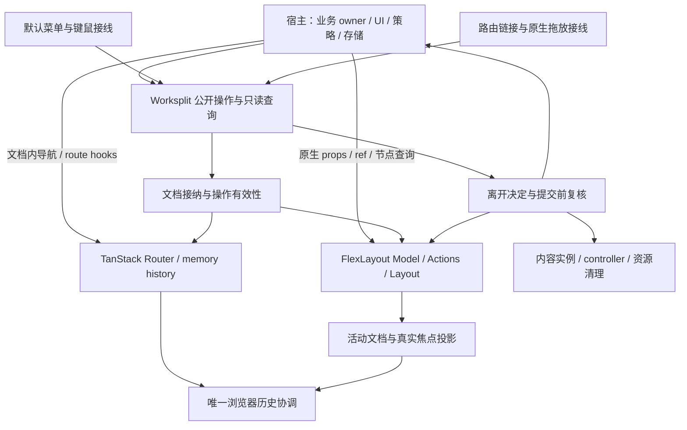

# Worksplit 整体重构提案

状态：**待实施，2026-11-04 修订**。本次只交付设计，不声明任何新 API 或运行能力已经实现。
决策来源：财务工作台下游于 2026-11-03 明确要求重新思考整个库，整合有价值的默认菜单，保持原生能力清晰，
彻底重构并由外部消费者迁移用法，**不保留旧接口兼容**。

11 月 4 日下游进一步要求以真实阅读、返回、编辑和多窗格需求预演架构，清理过时政策与不必要包装。
同日明确以库的中性、组合能力和 FlexLayout 知识复用为目标，将上游升级成本纳入设计取舍。
随后进一步明确：常用组合也是库的责任，不能把“不含业务假设”写成“所有选择都由下游重做”。
整体复查以无旧 API 兼容负担为前提，重新选择内容所有权、导航路径、竞争范围、启动和包边界；现有提案同样可以被证据修正。
先用[场景预演](worksplit-redesign-scenarios.md)理解需求怎样组合，再读本文的目标契约、迁移与验收。
共同约束在[设计原则](../design-principles.md)，执行顺序在[实施说明](worksplit-redesign-implementation.md)。
预演页拥有需求证据和取舍推导，本文是目标接口与行为的唯一权威。当前实现见[架构](../../refactor/README.md)、
[行为契约](../vscode-workbench-behavior.md)及[资源契约](../resource-lifetimes.md)。

## 目标与完成定义

交付一个能直接使用、能明确扩展的 React 工作台：下游定义 TanStack 路由、提供业务内容与离开决定，
便能使用原生布局、完整右键菜单、分组、复制、预览、拖放、焦点协调和资源清理。
应用的阅读下探与返回层级、2×2、预览方向与比例、产品选窗、保存回执、共享草稿和 UI 主题不进入协调内核。
通用旁开等内置组合直接使用同一公开机制，既不要求下游重复接线，也不形成第二条执行路径。

这是整个公共 API 和内部职责的统一替换，不按多轮设计保留几个并存架构，也不能以只改命名、只移动文件或只移出 placement 交付。
实现可以按依赖顺序推进；最终公共导出、运行行为、demo、独立制品、文档和迁移说明必须指向同一套设计。

不保留旧 hook、别名、重载兼容、弃用转发、legacy 配置、旧菜单实现、双放置流水线或旧快照转换器。
合理的已有函数名、算法与保护测试可以继续使用，它们必须直接属于新契约，不经兼容层。
外部应用迁移用法；库不能为了让未迁移下游暂时编译而恢复旧入口。

不兼容不等于可以丢弃数据。草稿、业务数据库和共享服务仍由应用维护；无法恢复的布局必须明确失败并允许应用选择重置，不能静默清空。

## 调查基线与证据边界

| 对象        | 本次读取基线                                    | 结论的范围                                                       |
| ----------- | ----------------------------------------------- | ---------------------------------------------------------------- |
| Worksplit   | 原始运行基线 `265bbed1`；本轮读取 `6b36680`     | 后者只增加设计文档；公开导出、实现与测试仍为原运行基线           |
| 财务工作台  | 本轮 `0ce93ea4`，替代初审的 `48558515`          | 同标签下探/返回、右侧预览、菜单、可见读取、业务 scope 与内容接入 |
| 初审 Pluxel | 11 月 3 日读取 `0ca9e13a`，gitlink 为 `cd4104e` | 当时 Shell/Studio 有较早 hook；本轮未复查，不代表消费者最新状态  |
| 原生布局    | FlexLayout `0.11.1` 加仓库固定补丁              | 所有原生能力判断以该版本为基线；实施时如升级需重新验收           |

本次是源码与文档设计审查，另做了原生 history 的最小拒绝探针，范围见[预演证据](worksplit-redesign-scenarios.md#证据与阅读边界)。没有重新执行历史浏览器或宿主验收。
历史的 323 项库测试、宿主迁移与截图证明各自记录时点，不证明本提案已实施，也不证明另一 checkout 已加载相同制品。
财务源码路径以该仓库根为基准；Shell/Studio 路径以 Pluxel 仓库根为基准，实施者须核对实际 checkout。

### 重构必须消除的实际负担

| 现有负担                                                           | 目标边界与依据                                                                               |
| ------------------------------------------------------------------ | -------------------------------------------------------------------------------------------- |
| dirty 混合未保存与写入未知，保存改变 revision 后批准含义不清       | [内容决定](#内容-controller-与离开决策)区分事实、许可和实际保存依据，文档与工具一致          |
| 同标签下探、筛选和返回需要组合，现有 memory traversal 未经 blocker | [导航层次](#四种导航及阅读返回)保持原生 Router API，有限 history 适配补足受保护遍历          |
| 库内两/四窗格选位与 35% 绑住财务旧政策                             | [中性放置](#中性放置与应用策略)保留通用旁开组合，产品选择归应用，共用明确目的地接纳          |
| 多个宿主重复关闭范围、菜单键盘和工具揭示                           | [默认菜单](#默认菜单与键盘入口)与 activate 统一接线，原生条目和 Actions 可直接定制           |
| getLayout 深复制整个模型，宿主解析工具位置及每个窗格可见性         | [查询](#查询活动状态与焦点)提供原生事实，快照仅用于显式持久化                                |
| 文档实例、URL key、业务资源和阅读依据容易被混同                    | [术语](#公开术语)与[身份](#身份与原生导航)分别限定，不用 URL 变化推断草稿应销毁              |
| drop 丢失原生 index/组目标，异步操作易命中已替换的对象             | [链接](#文档链接与拖放)保留原生命中，接纳复核真实实例与插入位置                              |
| 浏览器接管、关闭决定、资源清理有重复或模糊完成点                   | [历史](#浏览器历史与工作台退出)、[资源](#内容资源工具与会话寿命)共享必要协调，分别定义提交点 |
| 通用命令体系、shell、SplitView 与 Workbench 依赖相互牵连           | [快捷键](#快捷键不再是一套命令平台)直接调用操作，[包边界](#包边界)只按独立消费者拆分         |

这些改变服务既有用户路径；不以新增公共模块、统一所有时序或删除有效保护来证明重构完成。

## 整体架构



这是内部依赖和所有权，不要求公开这些 controller 或建立对应的新包。
唯一长期布局是原生 Model，唯一文档内路由状态是 Router。Store 只维护 Worksplit 拥有的事实和必要失效通知，
不复制完整布局树、选中索引或路由 search。

菜单、点击、拖放和程序调用进入相同文档接纳/移除流程。布局动作直接表达为原生 Action；
Worksplit 增加的动作必须有内容语义，例如路由打开、复制文档和受保护工作台退出。

### 组合层次与原生知识复用

| 职责     | 保留的内容                                               | 下游如何组合                                                 |
| -------- | -------------------------------------------------------- | ------------------------------------------------------------ |
| 必要协调 | 内容实例、接纳、受保护离开、资源释放及活动/焦点/历史关系 | 调用有限文档操作；原生布局变更经 dispatch                    |
| 内置体验 | 通用旁开、范围关闭、默认菜单、链接与拖放接线             | 用完整常见操作；定制只替换目的地选择或呈现，保护仍走同一入口 |
| 宿主业务 | 下探、返回层级、业务目标选择、布局偏好与草稿协议         | 普通函数、React 与真实 Router 组合，不向库注册业务流程       |

这些是职责边界，不增加公共组合引擎或新的包层。核心能力不是每个业务动作的缩写集合。
一个熟悉 FlexLayout 的使用者应继续用 Actions.moveNode、原生节点查询和 ILayoutProps 表达布局，
无需学习一套 Worksplit 的 move/split/group/resize 对等方法。默认体验可直接使用，独有行为只组合实际需要的能力。
场景预演中的[原生接入例子](worksplit-redesign-scenarios.md#用-flexlayout-知识完成组合)用于检查这项目标。

### 常用组合的取舍

按[四项包装标准](../design-principles.md#适度包装的判断依据)审视整个公共面，保留如下边界。
表中是取舍理由；各接口的完整行为仍由后续所属章节维护。

| 使用面         | 库完成的组合及原因                                                   | 留给原生或应用的选择                                      |
| -------------- | -------------------------------------------------------------------- | --------------------------------------------------------- |
| 打开与放置     | 默认当前容器；可选 beside 选方向内已有窗格或新分屏，减少重复父链判断 | 明确 Destination、自定义 resolver；财务窗格上限与宽度规则 |
| 文档复用与复制 | open 统一身份/接纳；duplicate 复制已提交地址，避免手拼新 Router      | 应用选择业务目标，原生 navigate 保留文档内语义            |
| 揭示与焦点     | activate/reveal 完成选择、展开和焦点资格，不让页面串多个 Actions     | DOM 实际 focus 回调与业务定位；一般移动/尺寸仍用 Actions  |
| 关闭与菜单     | close 处理常用范围；默认条目带安全执行，定制 renderer 只管呈现寿命   | 原生条目/主题；应用确认文案和业务决定                     |
| 链接与拖放     | createLink 共用类型化目标、捕获、拖放接纳与结果反馈                  | 实际元素/组件；普通阅读、显式另开和页面返回由应用集中组合 |
| 决定与资源     | 唯一 controller、runEffect、尝试期清理，收拢失效和晚到释放           | 编辑冻结/保存依据、业务资源寿命及共享 owner               |
| 查询与订阅     | 内容位置、visible 与焦点投影，省去反复序列化/遍历                    | 原生节点继续可读；业务数据请求和缓存由应用调度            |
| 会话与恢复     | start/dispose、可选浏览器连接、明确快照导出，各自完成必要协调        | React 挂载、存储时机、项目切换和快照重置由宿主拥有        |

不再增加与原生 move/resize/rename 一一对应的方法，也不提供业务 read/back/report 命令。
上述组合随现有包交付，不需要 preset 注册、组合容器或单独安装一层平台；常规调用不暴露内部阶段。

### 公开术语

| 名称                             | 唯一含义                                                                   |
| -------------------------------- | -------------------------------------------------------------------------- |
| `TabSet` / `TabGroup` / `Border` | 原生布局节点，不另建同义 EditorGroup/PanelGroup                            |
| `containerId`                    | 当前 TabSet 或 Border 的原生 ID；分组另用 `tabGroupId`                     |
| `content`                        | 一次文档或工具实例；关闭后同 ID 重开是另一实例                             |
| `document`                       | 拥有 Router 的 content；工具没有隐式 Router                                |
| `documentKey`                    | 当前已接纳位置的复用候选键，允许重复；不决定实例唯一性、业务资源或内容寿命 |
| history entry                    | 某个 Router 历史中的位置与 state；不等于一层业务阅读                       |
| `activeDocumentId`               | 当前工作文档，即使焦点在工具或 shell 也保留                                |
| `focusedContentId`               | 实际焦点归属的内容；不能用活动文档代替                                     |
| `preview`                        | 可替换文档资格，与 native pin、不可关闭、持久化分开                        |
| `token`                          | 应用对一次离开决定所依赖状态的标记，不是业务 CAS                           |
| `snapshot`                       | 导出的恢复输入，非可写运行时状态或草稿归档                                 |

同一 content 可以在 Router 内从列表走到详情再返回，期间复用键改变，句柄与 Router 保持。
同一业务对象也可以由多个 content 展示；草稿是否共享、同资源筛选和冻结读取依据由应用判断。
库不增加业务资源 registry、阅读栈或结果缓存，实例和路由投影不能替代应用的资源代次。

### 原生扩展与写入边界

继续公开原生 `ILayoutProps` 的可组合呈现槽和真实 `ILayoutApi` ref；Actions、Node、DockLocation、JSON 和主题直接从 FlexLayout 导入。
类型从上游直接引用，并只排除明确由库拥有或当前不支持的入口；不复制一整份 props/节点接口、布局 schema 或 Action 枚举。
其余原生呈现能力保留原名称、参数和回调语义，避免逐字段映射。新增上游呈现属性沿原生类型进入，涉及生命周期的新入口仍需核对支持边界。
Worksplit 持有 `model`、`factory`、`onAction`、内容接纳和协调所需 drop 检查，宿主不能覆盖这些所有者。
已借出的原生节点与 Model 是可信扩展；不宣称 TypeScript readonly 能阻止宿主直接写 Model。

所有 owned mutation 经 `dispatch` 或文档操作。原生调用的同步 onAction 只负责拦截并启动同一操作，
不能为了适配同步 API 跳过异步决定；调用者取得完成结果必须使用 Worksplit 操作回执。
真实 native ref 的返回值继续服从上游，不能包装成虚假的已创建节点。
dispatch 是内容生命周期的集成入口，不是另一套布局解释器：无须内容协调的受支持 Action 在必要检查后直接交给原生 Model，
不转成自定义命令再翻译回 Action。当前确需拆解的删除适配按[固定补丁](#固定补丁的维护)独立维护。

## 目标公开 API

以下是目标命名和语义，不是现有用法。具体泛型必须沿用实际 TanStack 类型并在独立消费者中证明。
实现时若精确签名不能同时满足上游类型与本文不变量，应在本提案记录证据并同步修改类型、用例和文档；不能增加旧接口兜底。

| 入口                                                                | 责任                                                                |
| ------------------------------------------------------------------- | ------------------------------------------------------------------- |
| `createWorkbench(options)` / `<Workbench>`                          | 创建唯一会话、绑定原生布局；宿主拥有实例寿命                        |
| `useContent()`                                                      | 只借用当前内容的稳定实例句柄，不登记 owner                          |
| `useContentController(controller)`                                  | 在内容根显式登记唯一 controller；参数必须传入                       |
| `content.runEffect(setup)`                                          | 立即启动一个内容所有的资源 effect，返回幂等 stop                    |
| `open(navigation, options)`                                         | 原生路由目标进入统一接纳流程                                        |
| `beside({ direction, ratio? })`                                     | 返回 destination resolver；只选择通用旁开位置                       |
| `createLink(navigationOrResolver, options)`                         | 点击和显式拖放共用 open；保留路由类型推导                           |
| `duplicate(id, options)`                                            | 从已提交 URL 建立新普通文档，不复制草稿                             |
| `keepOpen(id)`                                                      | 将预览变为普通文档；仍可关闭，不表示 native pin 或永久保存          |
| `activate(id, options)`                                             | 揭示现有文档/工具，并按显式 presentation 协调焦点                   |
| `save(id)`                                                          | 调用该内容的宿主 save 能力；文档和工具一致                          |
| `close(target, options)`                                            | 接受 ID/IDs 或有界原生范围，捕获实际实例后统一决定并关闭            |
| `closeWorkspace(options)`                                           | 对全体内容取得离开许可，再终止工作台；区别于标签的 pin/不可关闭限制 |
| `dispatch(action)` / `canDispatch(action)`                          | 提交/预检原生动作；预检不是许可承诺                                 |
| `getContent` / `getDocument` / `getDocuments` / `getActiveDocument` | 当前只读内容投影；找不到返回 null/空集合                            |
| `getContainers()` / `getContext()`                                  | 原生容器事实和活动/焦点投影，零序列化                               |
| `useWorkbenchState(instance, selector)`                             | 只读选择性订阅，不创建另一份可写 store                              |
| `createSnapshot()`                                                  | 明确导出原生布局和文档恢复信息                                      |
| `start(options?)` / `dispose()`                                     | 一次初始化快照/URL及可选浏览器连接；强制资源终止                    |

不继续公开可直接构造的实现 class 和内部状态访问器。`WorkbenchInstance` 可以保留为由 factory 返回的公开类型。
一般查询不产生 Promise；有完成回执的内容/布局操作统一返回 Promise。命令的成功时点见下表，不能推断 DOM 或业务保存已完成。
`keepOpen` 等同步原生效果可以在调用内完成，但仍按共同结果返回，默认菜单不用另外处理一套 silent void。
共同结果只统一消费方式；同步原生效果直接执行，不为它们新增通用任务队列、持久操作记录或命令中间件。
每个操作只返回实际可能的结果分支；例如 dispose 不要求处理 denied/superseded。共用词汇不等于所有方法机械套用最宽泛型。

### 配置归属与最小接入

创建参数只包含 createRouter、初始状态、工具定义、布局政策、预览作用域、home、会话标识、可选 workspaceLeave 和 issue 通知。
`createRouter(history)` 返回真实 Router；它如何提供 route tree、应用 context、Query client 和其他服务由宿主负责。
`initial` 使用 `{ layout: IJsonModel } | { snapshot: unknown }`，两种输入互斥；不传时使用无业务上限的空中央布局。
不接受已被其他工作台使用的 mutable Model 作为第二所有者；下游通过原生 JSON 配置、原生 props/ref 和查询获得原生能力。

home 使用 `{ mode: "empty" | "route", href: string }`；默认空工作台，涉及浏览器时必须有明确合法 home URL。
workspaceId 用于恢复和历史归属；需要跨重载恢复的宿主必须提供稳定值，临时嵌入实例可以使用自动生成的会话标识。
不同实例不能靠默认固定字符串共享历史空间。

创建时固定会话配置，不通过修改传入对象或 React rerender 更换 createRouter、工具定义/解析器引用、home、布局政策与预览作用域。
不提供通用 setOptions。业务偏好需要改变时，普通策略函数可读取应用当前事实；若决定依据改变，相关待提交操作重新复核。
需要更换项目/路由定义等会话身份时，先受保护退出，再创建新实例。menus/native 呈现参数则随 React 已 commit 的 props 更新，
controller 也只采用已 commit 的声明。三种生效时机明确分开，不把所有参数做成可热替换服务。

`<Workbench instance={workbench}>` 只负责内容 provider、原生 Layout、焦点观察和默认菜单；menus、native 呈现槽、
native ref 与样式放在组件参数。移除 navigation/sidebar/shell 布局参数，由应用在外部直接组合 React。
同一实例只绑定一个 Layout，重复挂载明确报错；组件卸载解除视图与菜单，不自动代表宿主同意丢弃整个会话。
宿主 effect 明确创建/终止实例，测试必须覆盖 StrictMode 下实例、视图和实际资源寿命的区别。

README 必须给出一个可复制运行的最小只读例子，以及在同一例子上增加 controller、工具、菜单定制、快照存储的接入方式。
不能让最小例子先安装一套应用命令框架、自己实现默认菜单或手工连接内部模块。

### 共同结果

建议固定下面的判别结构；操作具体 payload 仍有专用类型。

```ts
type OperationResult<T> =
  | { status: "applied"; value: T; cleanupErrors: readonly unknown[] }
  | { status: "denied"; reason: DenialReason }
  | { status: "superseded" }
  | {
      status: "failed";
      phase: "prepare" | "commit";
      error: unknown;
      changes: "none" | "some";
      affectedIds: readonly string[];
      cleanupErrors: readonly unknown[];
    };
```

`DenialReason` 是库明确列出的代码，如 decision、missing-content、missing-capability、layout-policy、focus-conflict、busy、not-ready、state-changed、unsupported-action。
应用自己的拒绝原因可作为附加信息传递，不进入库的业务分支。`superseded` 表示操作失去接纳/发布其文档结果的资格，
不证明底层请求已取消，也不保证原生 history 尚未前进或 loader 没有副作用。不能以回滚物理 history 来伪造无效果。

| 操作                   | applied 的精确时点                                                |
| ---------------------- | ----------------------------------------------------------------- |
| open / duplicate       | 路由结果已接纳、原生节点已入树、文档身份已登记；内容可能尚未绘制  |
| activate               | 揭示/选择和活动状态已接纳，焦点请求已登记；不承诺输入框已经挂载   |
| save                   | 宿主保存回调成功返回；库不据此宣称所有修改已清除或替代业务回执    |
| close / closeWorkspace | 原生移除/会话终止已发生，固定的已知清理集合已结算                 |
| dispatch               | 支持的原生 Action 已提交，必要的内容协调已完成                    |
| start                  | 初始化被接纳，结果明确是文档还是空 home；不是全部恢复文档加载完成 |
| dispose                | 强制终止已发生，固定的已知清理集合已结算；清理错误随结果返回      |

预期拒绝和被取代都返回结果，异步运行失败也返回 failed；内容/布局操作的参数错误同样通过结果表达，不能同一失败有时 throw、有时静默。
配置创建/绑定的无效结构可以在安装资源前同步抛出；createSnapshot 的同步序列化错误由调用者捕获。
这些同步入口不伪装成内容操作，公开异步内容/布局操作的失败则统一由结果表达。
原生 observer 抛错可能发生在变更之后，必须回读真实状态，列出实际影响并释放已经移除的内容。
`denied`/`superseded` 不能用于掩盖已经接纳的文档、原生移除或可见布局部分变更；这些必须报告 applied 或 failed(changes:some)。
此边界与原生导航尚在进行时的内部 history/loader 效果分开，禁止假装 Model/Router/业务保存共有事务回滚。

程序调用者处理返回结果；库拥有的原生 UI/默认菜单消费同一结果并向 `onIssue` 报告一次。
正常拒绝的提示由应用决定，不能自动当异常 toast。后台无等待者的失败由 onIssue 处理；reporter 抛错不能中断清理。

Router 已接纳的 loader error/not-found 页属于已打开文档，open 返回 applied，错误由原生边界呈现；
failed 只说明 Worksplit 接纳/布局/协调无法完成。内容渲染错误按内容隔离，不销毁其他内容或重建 Model；
原生错误恢复/重试仍由 Router/应用负责，Worksplit 不默认重跑 loader 或业务写入。

### 竞争按实际影响范围处理

普通打开独立准备和接纳；新的前台意图只撤销旧请求的焦点、选择和浏览器发布资格。
如果一个普通 activate 打开较慢，期间用户转到另一文档，而它的来源/目的地仍有效且可合法 background 接纳，新实例可作为后台标签接纳。
目的地无法满足后台不改变既有选择/显隐的条件时返回 superseded，不擅自换目的地或改变原生布局来伪造后台效果。
open 的 applied payload 明确返回实际 `presentation`，调用者能区分前台与后台；不能先夺回焦点再补救。
没有新实例且仅需揭示已有文档时，过时的呈现请求直接 superseded；已发生导航则按实际效果报告。
显式 reveal 的来源保护仍必须成立，不自动改成 activate/background；预览也不允许后台降级。

| 竞争对象                   | 范围与处理                                               |
| -------------------------- | -------------------------------------------------------- |
| 同一文档的导航             | 原生 Router/history 决定取代；库关联该次结果与保护寿命   |
| 同一预览作用域的新预览     | 后一次选择取代尚未接纳的旧选择；已接纳内容按预览协议处理 |
| 同一内容/相交关闭范围      | 相同请求复用，其他重叠返回 busy；无关内容仍可操作        |
| 焦点、活动文档与浏览器地址 | 仅最新有效的前台请求可发布，后台接纳不抢占它             |
| 关闭工作台或 dispose       | 会话级资格失效；禁止晚到内容重新接纳                     |

不保留一个全局 openEpoch 来取消所有普通打开，也不把 browser 的物理恢复忙碌扩成所有后台读取/布局查询的锁。
临时保留的实例、目标、范围及代次只覆盖本操作需要的事实；无关文档更新、尺寸变化不应一概使批准失效。
没有新公共 operation registry、事务队列或锁配置；内部分工必须能解释每个资格究竟保护哪项效果。

## 内容 controller 与离开决策

### 分离读取、决定和资源

```ts
type LeaveToken = string | number;

interface LeaveState {
  readonly hasUnsavedChanges: boolean;
  readonly token: LeaveToken;
}

type LeaveDecision =
  | { decision: "allow"; token: LeaveToken }
  | { decision: "deny"; reason?: string };

interface ContentController {
  title?: string;
  leave: null | {
    getState(): LeaveState;
    decide(request: LeaveRequest): LeaveDecision | Promise<LeaveDecision>;
  };
  save?: () => void | Promise<void>;
  focus?: () => void;
}
```

`leave: null` 明确声明没有应用离开限制；只读内容可以完全不登记 controller，或登记 focus 能力并显式 leave:null。
存在 leave 时两个函数都必需，不能允许半份保护定义。hook 不接受省略参数来切换角色。
`useContent()` 可以在多个子组件调用；同一内容只允许一个 `useContentController` owner，重复登记明确报错。
可选 title 是当前已提交资源的自动标题候选，遵守[标题所有权](#标题所有权)；它不替代原生 name，也不推导编辑或复用身份。

`LeaveRequest` 使用判别联合：close、navigate、replace-preview、leave-workspace。共同字段包括内容身份、
这次操作捕获的 `state`、必有的 `signal` 和 `defer(cleanup)`；navigate 提供原生 location 类型的 from/to，工具不会收到 navigate。
from 指最后已接纳的文档位置，to 指这次请求目标。前一次导航尚在加载时，history 的物理当前位置可能已经前进，
不能把它冒充当前编辑资源；原生 blocker 的物理位置留给内部协调，应用仍以捕获的 editor/resource 为决定依据。
close/replace-preview 可带当前文档 location；工作台离开可带外部目的地。不要重新定义 pathname/search 解析器。
signal 属于单次离开尝试：提交前的拒绝、取消、失效或异常都会结束它；删除在本次实际移除与内容失效处理完成后统一结束，
导航在本次原生转换最终接纳或明确终止后结束。结束时 abort 仅用于释放尝试期资源，不表示保存成功或导航被拒绝。
应用可用它释放临时编辑冻结；必须绑定原资源实例、幂等释放，不能解锁同 ID 的另一个 owner。
批次任一成员拒绝或最终复核失败时，结束全部已发出的成员尝试，包括先前 allow 的成员。
预览新页已接纳但旧页保留时也结束旧页尝试；删除中的同步 abort listener 不得插入本次移除处理的中间。

常用接入通过 `request.defer(editor.pauseEdits())` 登记释放；pauseEdits 是应用提供的、返回本次暂停释放函数的能力。
defer 沿用 runEffect 的登记习惯：所有尝试终态逆序执行一次，已经结束后才登记则立即执行；无需宿主重复检查 signal、绑定事件和移除 listener。
先标记本次全部参与尝试已结束并捕获清理集合，再调用 abort listener/清理，防止同步重入观察到半结算状态。
这里只登记同步的临时释放，不把保存、RPC 或异步业务清理放入尝试结算。某项抛错仍执行其余项，沿共同结果/onIssue 规则报告一次；
已有结果无法承载的拒绝、取代及晚登记错误交给 onIssue。signal 仍表示尝试寿命结束；成功也可能结束它，不能将 aborted 当作导航失败。
保留这个寿命含义是为了结束晚到的尝试期工作，与 runEffect 一致；业务成功由实际回执/已接纳位置判断，defer 是更简单的释放入口。
该便利方法不生成 token、不自动保存，也不猜何时冻结。应用返回的 release 只释放本次持有的暂停引用，
并发尝试不能共用一个“结束时直接设回可编辑”的布尔开关。

getState 同步从应用的同一快照读取修改事实和 token。hasUnsavedChanges 只表达未保存修改，
**不是是否调用 decide 的门槛**。即使为 false，leave.decide 仍可以因 pending write 拒绝。
同资源的筛选变化可以由应用按 from/to 直接允许，不必把一次 query 导航当成丢弃草稿。

token 应覆盖应用用于离开判断的修改、待确认操作和资源代次。任何相关变化必须使旧 token 失效，包括 A→B→A；
可以复用已有修订或组合标记，库不维护业务版本。库另外捕获真实内容实例、controller 登记身份、路由/操作代次和目标范围。
两个不同内容的 token 恰好相等，不意味着共享一次批准。
token 限于非空字符串或有限安全整数，比较保留类型；NaN、对象引用和不稳定序列化不能作为批准依据。

### 批准绑定哪一份状态

allow 必须携带应用**实际审核或确认保存成功**的 token。它可能与请求初始 state.token 相同，也可能因成功保存而更新。
库在提交前读取当前 getState，要求 token 与批准一致，并复核库自己的全部实例/范围资格。

三种具体情况：

1. 放弃当前修改：对话框展示的是 t7，就只能批准 t7；等待期间变成 t8，旧批准不生效。
2. 保存并关闭：应用冻结待保存状态 t7，按自己的协议保存；确认结果后产生能证明该内容已安全处理的 t8，批准 t8。
   保存期间若出现未被覆盖的新编辑 t9，应用不能将“刚读到的最新 t9”作为本次保存的批准。
3. 无未保存修改但写入未知：state.hasUnsavedChanges 可以为 false，decide 返回 deny，应用显示待确认回执提示。

不要提供一个“对话框返回后批准当前 token”的默认 helper；它会把用户尚未确认的新编辑一起批准。
示例中的应用保存函数必须返回它实际处理过的状态依据，或在返回前证实没有新编辑。
批准仅对这次请求有效，不持久化、不跨再次打开复用、不作为可以由应用长期保存的通行证。

### 共享决定与不同提交点

1. 捕获内容实例、原生节点、controller、路由代次、原生范围和可关闭性，预留操作，处理重复和重叠请求。
2. 读取所有受保护成员的状态；对这次范围依次请求决定，避免并行弹出多个确认框。
3. 每个 allow 保留其 token；任何 deny、取消或失效结束整个待提交请求，保留内容和资源。
4. 最后统一复核所有批准 token、成员、原生节点身份、controller、路由代次、焦点资格及原生关闭条件。
5. 对关闭，在不再次 await 的提交区内执行获准原生删除，并立即使被移除的内容实例失效。
6. 启动全部已移除内容的清理，等待固定集合，返回实际结果。

不 await 只排除了异步插入，不能隔绝原生同步回调。每个后续破坏性步骤执行前仍复核尚未移除成员的批准，
例如 A 的 native close 回调改变 B 的 token/owner 时，保留 B，已删除 A 按 failed(changes:some) 如实结算。
批量删除需保留这些可复核的步骤，不能封成一个无法插入检查的原生 Action group。
单个原生动作内部没有中间 veto；onBeforeAction 等可信扩展不得在该同步提交栈中改写本次批准依据或直接移除受保护内容，
相关业务反应应延后到提交完成。库不宣称隔离任意原生回调，也不以回滚 Model 伪造事务。

导航复用相同的状态捕获、决定和放行前复核，但由 TanStack blocker/Router 继续。
所有文档内入口，包括原生 Link/navigate、reuse:navigate、history 遍历和 browser visit，都由真实 history blocker 调用一次离开决定。
程序入口只关联回执与实例资格，不先调用 decide 再用 approved[href] 让 blocker 跳过；原生其他 blocker 仍可独立拒绝。
已在早期选定既有实例时，编辑器未获准前不先用另一个 Router 执行其目标 loader；未命中候选的晚匹配代价见打开路径。
原生 redirect continuation 的 ignoreBlocker 仍按该尝试的批准寿命处理。
blocker 放行与最终路由接纳是两个时点，中间仍有 loader、redirect、失败或被更新导航取代。
当前公开 Router 事件是通知，没有可 await/veto 的最终 commit hook；不能把 onLoad 返回 false 当作第二次批准，
也不能将导航写成与原生删除相同的同步提交事务。

普通可编辑宿主的跨资源导航采用一条明确路径：应用决定离开资源时，在返回 allow 前冻结该资源的编辑命令入口，
完成审核/保存并批准实际 token，把冻结释放登记到 request.defer。冻结覆盖所有修改入口，不能仅禁用一个输入框。
库负责让未进入 Router pending 的失败/取代也结束尝试；已经放行的转换则关联原生结算，
在最终接纳或确定终止前保持冻结，不因组件暂时隐藏或回调更新提前结束。
应用仅在原生已提交的资源转换后更换草稿引用；失败留在旧资源时恢复可编辑性，不提前丢弃状态。
外部共享编辑若仍可发生，应用必须保留其独立草稿 owner，并通过 workspaceLeave 保护，不能把它作为已批准内容清掉。

同资源筛选可以不冻结，但应用需能证明该路线及其 redirect 不会离开资源；否则按资源离开处理。
已批准的资源离开覆盖本次 Router redirect 链，不在每个 redirect 另弹确认；loader 的业务副作用由应用负责。
库不重新实现 loader/redirect、不承诺回滚已发生的路由或业务效果。先用[编辑预演](worksplit-redesign-scenarios.md#编辑保存与路由提交)验证这条时间线，再扩展整套接口。

相同待处理关闭可共享一次决定；重叠但不同的范围明确返回 busy。新的导航/历史操作撤销尚未放行的旧决定，应用可关闭旧对话框。
已经放行的旧转换则按原生取消/接纳结算，不用提前 abort 假装它从未发生；后继尝试的保护须连续接管。
例如 T1 已放行但 loader 未完，T2 被其他 blocker 拒绝；结束 T2 只能释放它自己的暂停引用，T1 的编辑保护仍在。
保护引用属于原 editor owner，库负责每次尝试恰好结算；不为这个问题新增公共导航队列或业务锁平台。
回调不得再次调用当前正在等待它的 close/dispose，不能制造重入等待环。

批次的 all-or-none 保证只针对**决定完成前不删除任何成员**。应用已经保存的内容不会因另一个成员拒绝而回滚。
原生提交时的异常或同步回调造成的批准失效可能留下部分效果，按共同结果报告并完成必要清理，不能通过重建 Model 抹掉事实。

### 预览替换与退出

自动预览替换不能弹出一连串丢弃对话框。reason=replace-preview 必须按非交互上下文交给应用判断；
hasUnsavedChanges 为 true 的旧预览直接保留为普通文档，其他有 guard 的旧预览仍需取得非交互 allow。
拒绝或状态改变时保留旧内容为普通文档，新文档接纳成功后才结束旧预览资格；新文档失败不破坏旧预览。

closeWorkspace 覆盖文档和工具，也询问 native pin/enableClose:false 内容的应用决定：这些标记限制标签操作，不能绕过工作台退出保护。
待决定期间不销毁 Router、资源或浏览器连接；提交时统一终止。结果和批量关闭一致，已失败的宿主保存不隐式重试。
宿主如果存在不属于任何打开标签的共享草稿/项目操作，可提供 workspaceLeave，使用相同 getState/decide 与批准 token 协议，
只接收带外部目的地（如有）的工作台离开请求。它作为同一批次的一个额外参与者，统一最终复核；不另建第二层退出状态机。
内容关闭不咨询 workspaceLeave，强制 dispose 也不咨询；此入口不能替代每文档导航与关闭保护。
dispose 继续是幂等的强制资源终止，明确不弹窗、不保存；正常退出按钮和外部导航不能把它当作确认流程。
浏览器刷新、关闭窗口仍受 beforeunload 约束，由宿主提供同步提示策略；不能承诺异步保存或完成远端清理。

### React owner 的存在性

controller 只采用已 commit 的回调，丢弃的 concurrent render 不得改变保护。
持续根 owner 放在会被隐藏/重挂载的业务子区域之外；原生移动、选择、折叠和最大化不撤回它。
资源 effect 的 React cleanup 不撤回编辑决定。
同一个 hook 登记的 owner 身份稳定，普通 rerender 更新 committed 回调不会变成新 owner；
否则保存触发 React 更新就会使所有“保存并关闭”失效。业务决定依据改变由 token 表达，
真正 owner 重登记、内容实例变化、保护从有到无等结构变化才另外撤销尚未交给原生继续的批准。
已经放行的导航按原生转换结算，不能因 owner 隐藏而提前结束尝试期保护。

对已经登记过保护的存活内容，owner cleanup 到重新登记之间必须视为保护暂不可用，拒绝新的离开操作，不能当成 clean。
StrictMode 的 setup/cleanup/setup 与同 ID 重开使用真实登记身份区分，不用延时猜测“应该还是同一个 owner”。
显式提交 leave:null 才表示应用主动撤下限制；controller 更换或保护撤回必须使尚未放行的批准失效。
测试必须覆盖完整 owner 暂停，不能仅靠“调用者不应在此时关闭”的文档回避数据保护。
从未挂载/登记 controller 的恢复项不拥有内存编辑状态，不为关闭它而加载全部后台 Router；关闭仅移除布局项。
应用不能在 controller 登记之前让内容产生需要保护的编辑，也不能在组件卸载后把共享草稿所有权交给这个空壳标签。
独立于内容存在的状态由宿主保留，并在退出会话时通过 workspaceLeave 提供保护。

### 宿主接入示意

下列只展示声明位置，`editor`、`decideEditorLeave` 是宿主实现。
实施交付的编辑示例必须完整展示冻结、保存实际依据、新编辑拒绝和 signal 结算，不能用这个占位函数代替验收。

```tsx
function DocumentRoot() {
  const content = useContent();

  useContentController({
    leave: {
      getState: () => editor.readLeaveState(),
      decide: (request) => decideEditorLeave(editor, request),
    },
    save: () => editor.save(),
    focus: () => editor.focus(),
  });

  useEffect(
    () => content.runEffect(({ defer }) => defer(editor.subscribe(refresh))),
    [content, editor],
  );

  return <Outlet />;
}
```

纯只读页面无需伪造 dirty/token。共享草稿由宿主 owner 维护，一个视图关闭只释放引用；
decide 若选择丢弃共享修改，宿主必须按自己的共享资源语义执行，库不替它决定。

## 文档、打开与路由身份

保留每文档真实 Router 和独立 memory history，共用应用 route tree/context 服务。
route hooks、Link、navigate、loader、Outlet、Wrap/InnerWrap 与错误边界继续原生。
跨文档 open/createLink 使用原生 NavigateOptions 泛型；不建立第二套路由注册表或简化 navigate DSL。

### 打开选项

打开表达三类独立信息：复用政策、呈现意图、目的地。目标类型至少具有下面的约束：

```ts
type OpenPresentation =
  | { presentation?: "activate" | "reveal"; preview?: boolean }
  | { presentation: "background"; preview?: false };

interface Destination {
  target: string;
  location: DockLocation;
  index?: number;
  ratio?: number;
}

type OpenOptions = OpenPresentation & {
  source?: ContentHandle;
  reuse?: "preserve" | "navigate" | "new";
  destination?: Destination | DestinationResolver;
};

type DestinationResolver = (context: PlacementContext) => Destination | null;
```

source 绑定实际内容实例，不只保存可复用的字符串 ID。默认来源在调用时捕获，不在 loader 之后猜测最新活动文档。
默认 reuse=preserve、presentation=activate、preview=false；来源在中央时默认目的地为其容器 CENTER，
否则使用调用时捕获的活动中央容器。来源焦点与中央放置锚点分别捕获，不能把 Border 工具误当中央窗格。
没有活动中央容器时选择已有的首个合法中央容器；完全没有中央容器时通过原生 ADD 建立首个 TabSet，仍受布局政策约束。
这是空布局的接纳默认，不是自动增殖窗格的产品规则；显式目的地失效不能悄悄退回默认位置。
reveal 没有可保留的来源时拒绝。ratio 只能用于新建的中央边缘分屏，范围为 (0,1)，不提供财务 35% 默认；未给出时沿用原生尺寸。
DockLocation 是原生对象，部分约束无法由字面量联合判别，必须在公开边界运行时验证，不能宣称类型消除了全部错误。
target 接受存活的 TabSet、Border、TabGroup；空主布局的 root Row 是建立首个窗格的特殊目标。
Border/TabGroup 只接受 CENTER；index 直接使用原生 ADD 的插入序号语义，默认 -1，不用完整关闭范围的叶子序号重新解释。
ratio 只对可明确识别的新建 TabSet 分屏对生效，不为 TabGroup、Border 或任意 Row 猜权重。

| presentation | 显示/选择目标                | 活动文档与浏览器地址                     | DOM 焦点                         |
| ------------ | ---------------------------- | ---------------------------------------- | -------------------------------- |
| activate     | 揭示并选择                   | 文档按操作规则更新；工具保留最近工作文档 | 登记内容 focus 请求              |
| reveal       | 目标在独立可见容器显示       | 保留来源文档及地址                       | 保留实际来源焦点，无法保证时拒绝 |
| background   | 添加而不选择；不展开隐藏区域 | 保留                                     | 保留                             |

不同策略不是 bool 的随意组合。默认菜单的“向右/向下拆分”是明确 native MOVE；打开新文档的 destination 是 ADD 接纳，两者不能混用容量预测。
复用已有文档默认保留其位置；destination 和 ratio 只作用于新实例，不把复用变成隐式移动。
duplicate 等价于已提交 URL 的 reuse:new、普通文档；创建独立 Router/内容寿命，不复制草稿、选择或滚动。

### 中性放置与应用策略

保留 placement 的设计意图：让常用的“在旁边打开”成为一次完整调用。移除的是旧 placement 选项与内置财务规则，
不移除有价值的默认组合。只保留一个 destination 入口：可传明确目的地、库的 beside，或应用自己的 resolver。

```tsx
import { beside } from "@worksplit/react";
import { DockLocation } from "flexlayout-react";

const result = await workbench.open(target, {
  source: content,
  destination: beside({ direction: DockLocation.RIGHT }),
  presentation: "reveal",
  preview: true,
});
```

这是目标用法。beside 返回普通 DestinationResolver，不创建文档、不持有状态，也不拥有专用接纳路径。
direction 必填且仅接受原生四个边缘方向；ratio 可选，只用于最终新建分屏，既有窗格不改尺寸。
其默认选择固定为：

1. 使用本次调用捕获的中央锚点。初始没有来源/锚点，或中央锚点本来为空时，沿 open 默认目的地接纳首项，
   不制造空白分屏。已捕获的来源/锚点后来失效仍拒绝；reveal 缺少可保留来源仍拒绝，不能把它混同普通首开。
2. 沿锚点的真实原生父链由近到远查找该方向的兄弟分支；同层由近到远、分支内按原生 TabSet 顺序，
   取第一个 `canPlace({ target, location: DockLocation.CENTER })` 通过的中央窗格。Border 不参与自动候选。
3. 没有适用窗格时，检查以锚点为 target、指定方向为 location 的新分屏；仍不可接纳则返回 null，由 open 明确拒绝。

“旁边”按原生分割结构定义，不承诺像素距离最近。两个窗格也不忽略方向，达到布局上限也不改去其他方向。
不内置 MRU 优先、财务 2×2 或比例；需要这些产品选择时用自定义 resolver，而非继续给 beside 增加模式开关。
显式 drop 跳过点击的 resolver；菜单分屏仍是原生 MOVE。复用已有文档时先按 reuse 处理，不运行旁开选择或搬动它。

目的地 resolver 是同步纯函数，在候选路由最终身份已解析、确实需要新实例时调用一次；不能做业务写入或返回 Promise。
它取得捕获的来源、实时原生容器、当前预览和必要的 MRU 投影，以及 `canPlace(destination)`。
其中 anchor 是捕获的原生中央 TabSet 或 null，defaultDestination 是普通 open 此时会使用的合法目的地或 null，
让内置和自定义策略都能复用首次接纳默认；这两项由同一捕获规则得出，不另存布局状态。
确需父链/方向时可以借用真实原生节点或 Model 只读查询，不转成第二份布局树；这仍是可信宿主扩展，不是隔离沙箱。

canPlace 由同一次真实接纳描述计算，覆盖 ADD 的原生可接纳性、结构上能否满足 presentation 与当前政策，
不要求应用制造假文档或用 MOVE 最后一标签来猜容量。它不取得异步离开许可，也不承诺稍后的实际焦点仍有效。
resolver 选出明确目的地，库再次检查来源/目标实例、布局、焦点和最终政策后提交。
所有候选检查共用一次 route load，不能每失败一个方向就重新运行 loader。
预检不能调用真实 Model.toJson() 或触发 save listener；不能承诺完整重放任意宿主 callback。

财务应用在普通函数中实现两窗格复用、按方向补齐至 2×2、右侧凭证预览和按实际宽度分配报表详情。
只有选择语义相同时才复用 beside；不能先执行一次 open 失败后再执行另一策略的 open 来模拟候选查找。
内置与自定义选择都把一个明确结果交给同一接纳点，null 是拒绝，不隐式回退默认位置。
demo 必须另给出无四窗格限制的宿主，以及固定右侧目标的简单宿主，证明算法没有隐含财务上限。
布局限制 helper 可继续提供 maxRows/maxColumns/maxTabsets，全部默认无限制；具体数值由宿主传入。

### 身份与原生导航

默认复用身份来自 Router 已接受的规范 path/search；hash 默认只作为页内定位。
使用原生解析/序列化，不另写 URL codec，不擅自排序数组或删默认 search 字段。
需要不同身份时，在原生 route metadata 声明纯 `documentKey`。从实际匹配链由叶向根找最近的显式声明，
只声明 title/navigationKey 的子路由不遮蔽父级 key。自定义身份由声明 routeId 与返回的非空字符串共同组成，
与默认 URL 身份分开命名空间；确需跨子路由共享时在共同父 route 声明，不新增注册表。
输入使用该原生 match 的已解析 params/search 与 location，身份依据必须可从已提交 URL 和静态路由定义重建。
不得依赖 history.state、原生 entry key/index、阅读父层、loaderData、编辑状态、时间或可变服务，
使懒恢复可以只匹配而不加载。库校验结果类型、非空并捕获异常；纯性和稳定性由宿主契约及恢复样例保证，
不能声称识别任意不稳定回调，也不为此重复调用回调或维护第二套 key cache。
旧 identitySearch 列表移除；documentKey 不拥有加载、草稿、业务资源代次或阅读返回。

| reuse            | 找到匹配实例后的行为                                                                |
| ---------------- | ----------------------------------------------------------------------------------- |
| preserve（默认） | 保留完整已提交 href/search/hash 和文档 history，按 presentation 处理呈现            |
| navigate         | 在选中的既有 Router 内导航到请求位置，经过同一离开保护，保留内容实例                |
| new              | 不选择复用项，创建独立 Router/history；duplicate 仅复制当前已提交 URL，且为普通文档 |

多个副本匹配时，按活动文档、MRU、原生活动 TabSet 的匹配选中项、创建/恢复登记顺序选择。
第三项保留尚无 MRU 的懒恢复选择。默认全 search 身份下 preserve/navigate 的差异主要体现于 hash；
使用自定义 key 忽略部分阅读条件时，navigate 才会改变这些条件，preserve 保留旧条件。
应用按报告 ID 选择一个已开报告属于业务入口政策，不应为此缩小所有报告的默认复用 key。
已选定具体实例时直接 activate 该实例并核对 handle；再次 open 同 key 会重新按上述顺序选择，不能保证仍是原副本。

documentKey 是候选索引，允许多个实例有相同 key。显式副本或原生 navigate/redirect 后相同都属于正常状态，
不再报告 native-identity-conflict，也不保留 multi/ordinary 特判；真正业务唯一编辑约束由应用 owner 承担。
索引引用实际内容 record，重建依据是已接纳位置；不能按 key 合并 Router、清草稿或改变原生导航结果。

### 打开先选择实例再加载

1. 捕获来源与目标约束，使用原生 URL 构造/静态匹配确定请求的规范位置和候选 key，不运行 beforeLoad/loader。
   精确 href 查找只能是不改变既定候选优先顺序的优化；自定义 key 下不能因精确 href 命中跳过活动文档/MRU。
   需要 Router 才能完成静态匹配时，候选仅构造一次，并由本次操作负责未接纳时释放。
2. preserve 命中已初始化会话就直接揭示，不执行请求目标的 loader/redirect，不把它当刷新。
   未初始化的恢复项只在选中的原 record 上，以其保留的已提交 URL 初始化一次；不改用本次请求中被 preserve 忽略的阅读条件，不新建文档副本。
   该 Router 正在初始化或导航时也不静默取消或另建 Router；初始化共享同一个进行中结果。
   navigate 命中则直接在该 Router 导航，由真实 blocker 决定；即使 redirect 后 key 与别人相同，也保留这次实例选择。
3. 未命中才加载候选 Router；沿原生重定向结算后按最终 key 再查一次，处理别名与并发接纳。
   仍未命中便接纳这个 Router，不创建第二个 Router 再加载；new 则跳过复用选择。
4. 晚命中 preserve 保留目标并释放候选；晚命中 navigate 仍必须经过目标活 Router 的保护和原生导航，不能注入候选 loaderData 或换掉目标 Router。

这是一条接纳路径里的早晚两次选择，不是两套导航实现。preserve 的含义是保留现有会话，而非每次重新验证请求可能发生的重定向。
静态 key 必须来自静态路由声明；不能为提前选择调用业务查询。晚命中 navigate 可能发生候选加载加活 Router 导航两次真实读取，
保留这项明确代价，不能宣称每次 open 只运行一次 loader；多个 placement 候选则绝不各自重复加载。

### 标题所有权

原生 name 是标签、溢出菜单和可访问名称的唯一最终标题。自动候选按已 commit 的 controller.title、当前 route 标题/工具定义、
文档 URL 回退选择；业务数据可产生候选，最终是否采用由同一内容的命名所有权决定。
内容初始为自动标题；显式原生 rename 或 updateNodeAttributes 的 name 写入将该实例标记为 manualTitle，
即使新文字恰好等于自动名也算手动意图；库内部采用自动候选与恢复初始化不归类成用户改名。
manualTitle 是一个布尔所有权标记，不保存第二份标题字符串；用户标题跨筛选、下探和 key 变化保持，不用字符串相等猜测。
业务自动标题不再通过原生 rename 冒充用户改名，而由已有内容 owner 提交 title；资源切换时撤回旧候选，不能用旧凭证名覆盖新资源。
隐藏但保活的 owner 可继续更新自动标题；未挂载的恢复项保留 native name，首次挂载后再更新自动候选。
复制仅 URL 的新实例从自动模式开始；快照保留手动标记和 native name，工具也不被定义默认名覆盖手工改名。
不新增 titleKey、标题 registry 或标题管理方法族；命名不改变 content、复用键或编辑批准。

### 四种导航及阅读返回

| 用户意图                             | 入口与唯一状态所有者                                                         |
| ------------------------------------ | ---------------------------------------------------------------------------- |
| 新开、复用、旁开或拖放文档           | Worksplit open/createLink；接纳后由该文档 Router 持有位置                    |
| 当前文档筛选、下探、子路由切换       | 原生 Router navigate/Link；不新建内容或整份 Router                           |
| 返回本次阅读来源                     | 应用在文档 history.state 记录来源，调用同一 history.go；库不定义业务阅读层级 |
| 浏览器 Back/Forward 或离开工作台范围 | 唯一 browser coordinator，按[历史行为表](#浏览器历史与工作台退出)协调        |

应用决定普通点击、修饰键另开和显式 drop 的不同意图。财务下探先按完整目标查找已开文档，
已有则保留式复用；否则在当前 Router 继续。这个入口政策不提升为全库拦截所有 navigate 的去重器。
同标签导航更新当前复用键，但不因键变化终止内容 effect；路由组件/业务资源自己的释放仍由原 owner 负责。

财务 `financialReadParent` 是当前文档 history entry 的应用 state。下探捕获来源 entry，筛选保留该 state，
同一单元格切换金额口径时 replace 当前 entry；返回跳过该层内的筛选，逐层恢复来源条件。[预演](worksplit-redesign-scenarios.md#同标签下探筛选与返回)给出具体序列。
应用扩展 state 与原生索引/key、Worksplit 浏览器 metadata 分开，不整包覆盖别人的 state。
复制、新开和布局恢复只带已提交 URL，不复制整条历史或伪造阅读父层；无父层时的具名返回入口由应用确定。
滚动、行选择和冻结金额依据也不由 URL/history 的存在自动恢复。

普通文档导航必须在 PUSH、REPLACE、GO、BACK、FORWARD 修改位置前调用同一登记 blocker，
带实际 from/to；拒绝时位置与应用 state 不变。当前锁定的 history 1.162.5 在 memory traversal 上不调用 blocker，
现有 document-history 包装只观察拒绝，不能满足该目标。
已批准尝试的原生 continuation/redirect 仍遵守 ignoreBlocker，不重复询问；宿主不得用该可信原生入口绕过编辑保护。
实现前先确认所选支持版本能否原生满足同一遍历保护契约；满足则直接复用原生能力，不为文档计划保留额外实现。
针对已证实有缺口的当前基线，路线是在现有 document-history 内基于上游公开 `createHistory` 提供一个有限 memory backend，
由它持有唯一 entries/index，使用原生解析、state 和通知协议；遍历先审查真实目标，再改 index 并通知。
通过公开 backend getLocation/getLength/pushState/replaceState/go/back/forward、getBlockers/setBlockers 与 onBlocked 接线，
禁用提前的 index-change 通知，获准后才 notify；直接使用原生 RouterHistory 类型，不扩展另一套历史接口。
不在 createMemoryHistory 旁镜像另一份 entries，不公开第二套 back/navigation API，不复制 Router 的 loader/redirect。
优先验证拒绝、快速交叉操作、state 保留与导航结算；上游等价能力通过同一回归后删除这一适配。
最终支持的版本与制品只走选定的一条路径，不按运行时能力探测保留原生/自建双实现，也不扩成通用 history backend 插件协议。
公开扩展点的可行性已由源码核对，完整 backend 尚未实现验证；这是实施的首个能力验证，不能用无 guard 的返回冒充完成。

### 预览作用域

提供明确的 `previewScope: "container" | "workspace"`，默认 container；财务应用选择 workspace 保持单一凭证预览习惯。
每个作用域最多一个可替换资格，实际内容是否可以移除仍由离开协调决定。
pin、keepOpen、复制或明确普通打开结束相应预览资格，不建立平行的 pin 状态。
移动预览到已有预览的容器时，已移动文档成为普通文档，目标原预览保持；不通过拖动触发隐式关闭。
新预览先成功接纳，再处理旧预览；资源复用不会移动目标或牺牲另一个未相关的预览。
旧预览的决定在新接纳前获取，破坏性移除前再次复核；新 ADD 的 observer 若使旧批准失效，保留旧文档并结束其预览资格。
此时新文档已经打开，应报告 applied，不能说整个 open 被取代且毫无效果。
如果实际删除旧预览，open 的回执还须等待该删除已知的清理集合，并把其错误放入 cleanupErrors。

### 文档链接与拖放

createLink 只负责共享路由目标、点击处理、延迟解析和原生 drag 接线。拖放命中/拖拽图像/清理交给 FlexLayout。
默认 drop 使用用户明确选中的原生目标，并打开普通 activate 文档；宿主可明确覆盖 preview/presentation，
覆盖仍通过同一合法性检查。click 的自动目的地 resolver 不能覆盖用户的 drop 位置。
drop 描述保留原生目标、DockLocation 和 index，不能自动改为追加；落入组时保留实际组身份。
异步加载期间目标成员顺序或组归属改变，使捕获的插入位置不再有效时拒绝旧操作，不能悄悄插到新序号对应的另一个位置。
只保存这次操作校验所需的原生实例/顺序依据，不持有另一份长期标签树。

延迟目标只在真实点击或接受 drop 时解析，取消拖拽不运行 resolver。调用时捕获 source 和 drop target 实例，
解析与路由加载后都重新核对；取消、源关闭/移动、目标移除、Layout 卸载和同一拖放尝试被取代都不能发布晚到文档。
无关普通打开的竞争按[实际影响范围](#竞争按实际影响范围处理)处理，不用一次新点击取消所有在途链接。
复用已有实例时仍遵守不移动规则；若宿主需要拖放必建副本，显式 reuse:new。
拖拽占位描述只用于原生命中，不得通过 public dispatch 注入伪装的 route document。
正常链接保留 href 和可选择文本，显式拖拽手柄与可访问名称分开；原生修饰键、新窗口链接与应用内打开的职责要在示例里明确。

链接对象至少保留 `href?: string`、`open(overrides?)` 与原生事件形态的 `dragStart/dragEnd`。
静态目标可提供真实 href；延迟目标在解析前不能伪造可访问地址，也不能为渲染 href 运行有副作用的业务 resolver。
宿主用自己的元素/组件接这些能力，库不再要求一套 Link 组件或导航 DSL。
`LinkOptions` 在 OpenOptions 外只增加可选 `onResult(result)`，不扩散到每个内容操作的参数中。
一次实际点击/调用 open/接受 drop 产生一个回执，onResult 接收一次；`link.open` 的调用者仍可 await 同一结果。
有 onResult 时由它消费该次结果；没有时，显式 link.open（包括宿主点击处理中的调用）由调用者消费回执，
库拥有且没有 await 调用方的实际 drop 则把 failed/cleanupErrors 交 onIssue。denied/superseded 不自动提示异常，不能根据是否 await 猜报告归属。
回调抛错只报告该回调错误，不改变原结果或再次执行打开。财务统一反馈在 pageLink/entryLink 工厂登记，页面不重复接线。

## 默认菜单与键盘入口

### 默认交付的能力

Worksplit 应默认安装完整菜单。一个只提供路由和内容的宿主就应具备下列适用操作，不需要复制 demo 的菜单文件。
实现使用原生 ContextMenuBuilder、PopupMenuEntry、showPopupMenu 和 Actions；新增的是文档语义与安全接线。

| 目标     | 默认菜单内容                                                                                          | 执行边界                                                  |
| -------- | ----------------------------------------------------------------------------------------------------- | --------------------------------------------------------- |
| 文档标签 | 保留预览、复制、置顶/取消置顶、原生重命名、分组、向右/向下拆分、最大化/恢复、关闭、关闭其他、关闭右侧 | 复制/预览调用文档操作，其余使用原生动作；关闭进入统一协调 |
| 工具标签 | 原生适用的置顶、名称、分组、停靠和关闭                                                                | 不显示需要 Router 的复制文档/预览；移动不改变工具角色     |
| TabGroup | 名称和颜色、折叠/展开、解散组、关闭组内标签                                                           | 使用原生分组状态；解散不关闭内容，整组关闭包含折叠成员    |
| TabSet   | 最大化/恢复、关闭窗格内标签                                                                           | 遵守原生可关闭性和应用布局限制                            |
| Border   | overlay/inline 切换、关闭容器内标签及适用的已有分组操作                                               | 保持原生边缘语义，不伪造中央分屏能力                      |

分组名称、颜色编辑优先复用原生菜单的编辑控件；宿主需要独立 Modal 时可以替换呈现。
不能为移入 Worksplit 而把财务应用的 HeroUI 弹窗、文案和项目 owner 一并搬入。
原生不为 Border 提供的默认建组入口，不因底层 JSON 能表达就无条件开放；已有 Border 分组的移出、解散、关闭需要实测并明确支持。

默认“向右/向下拆分”移动当前标签，不能偷偷复制文档；目标是当前 TabSet，受 pin、原生可移动性与布局政策限制。
当移出唯一标签不会产生有效额外窗格时禁用该项。“复制标签”单独建立新文档，两者不混淆。

### 范围、定制与焦点

范围关闭属于公开 close 操作，不只藏在默认菜单中；自定义工具条和快捷键无需递归 native tree 后再拼批准。
目标使用有限联合，不增加 closeGroup/closeRight 方法族或通用命令描述：

```ts
type CloseTarget =
  | string
  | readonly string[]
  | { scope: "others" | "right"; target: TabNode }
  | { scope: "all"; target: TabSetNode | BorderNode | TabGroupNode };
```

原生 Node 类型直接从 FlexLayout 导入。ID/IDs 是调用者明确选定的内容集合；范围目标是库负责展开和过滤的语义请求，
在 close 调用时绑定真实节点与内容实例。明确集合中不可关闭成员导致请求拒绝，不能静默漏掉被点名项。
all 表示目标内合格的叶内容，空容器整理仍由原生处理，不是强制删除容器；工作台退出另用 closeWorkspace。
存活但无合格成员的范围成功返回空关闭集合，失效目标明确拒绝。暂不增加 canClose/getCloseTargets：
默认菜单的 disabled 与 close 内部共用范围解析，程序入口直接处理回执；不能为了对称导出一组预检/解析/执行器。

关闭其他的作用域是目标所在的整个 TabSet 或 Border，包含其中所有 TabGroup 的叶子标签；all 使用明确传入的容器或组。
关闭右侧仅在中央标签条提供：按原生 children 的顺序递归展开组，取目标之后的叶子标签，包含折叠成员。
关闭组内只覆盖该组；菜单目标是什么和当前活动标签是什么无关。
范围计算过滤 pin 与原生不可关闭项，不把可见列表当全部内容；一个范围内的受保护内容统一批准后提交。

菜单打开时可计算显示与 disabled；执行前重新确定目标仍是同一原生节点、计算实时范围，随后冻结为本次关闭请求。
等待应用决定期间范围发生变化应使该请求失效，不能自动加入用户尚未批准的新标签。
名称/颜色编辑窗口在提交前同样检查实例；旧弹窗不能改到重用相同 ID 的新组。

公开一个 `menus` 选项，支持默认、`false`、或定制对象。定制对象接收真实 node、原生条目和 Workbench 操作，
可转换条目及替换 renderer；renderer 的销毁和返回焦点规则必须写在类型注释中。
默认零接线；只改文案/增删条目时保留默认呈现；只有改变 UI 时才替换 renderer。条目转换不要求再次实现关闭或执行时序。
条目沿用 PopupMenuEntry，不发明菜单 schema、递归权限规则、第二套 command registry 或私有主题系统。
标准标签的本地化复用原生 i18n；仅为 Worksplit 新增文档动作补充标签。

`native.onContextMenu` 作为完全接管入口时应显式关闭默认 menus；两者同时配置为有效值时在首次绑定 Workbench 时明确报错。
这样仍能使用真实原生扩展，也不会因覆盖顺序或双监听而弹两个菜单。
普通定制不需要接管原生入口，应用只增加自己的条目。

右键、Shift+F10、ContextMenu 键进入相同构建与执行路径；已有原生键盘处理的组 pill 不重复桥接。
菜单先实际关闭并完成原生 chrome 的焦点归还，再执行内容激活或弹出业务对话框，避免迟到 cleanup 抢回焦点。
renderer 只负责呈现、关闭/焦点归还，并在实际完成后通知库执行选中的条目；hide/setState 返回不证明清理完成，不用固定延迟猜测 React 时序。
库生成的条目闭包负责只执行一次、复核目标、调用相同操作和消费结果；renderer 不读取 token、不重新计算范围。
宿主新增条目的业务动作也在同一关闭完成点调用，业务动作自己承担其领域判断。完全接管原生菜单的高级宿主仍使用 dispatch/close。
自定义 React 呈现保留宿主 provider，不偷偷 createRoot 丢失主题/语言/业务上下文。
关闭工作台、切换会话或移除锚点时，菜单与编辑控件都必须清理；正常取消仅恢复仍有效的原锚点。

### 快捷键不再是一套命令平台

布局选择、拖动等使用 FlexLayout 原生 keyMap；菜单负责自己的可访问键盘行为。
应用的保存、打开、退出等快捷键直接调用 Worksplit 操作，宿主可以选择 TanStack Hotkeys 或其他已有工具。
删除库内通用 WorkbenchCommand/executeCommand 注册体系和必须安装的 Hotkeys provider/peer。
不再用一套字符串命令名转发到已有方法；文档展示“宿主快捷键 → save/close/open”的直接例子。
同一键只由一方处理，输入框、组合输入、repeat 与浏览器系统快捷键是否被覆盖由应用声明。

## 查询、活动状态与焦点

`getContainers()` 读取真实 TabSet/Border，返回 ID、类型、真实 native 节点、选择项及按原生完整叶序排列、含折叠成员的 tab IDs。
返回投影不提供 setter，不缓存一份可独立修改的布局树。`getContent(id)` 提供当前 containerId 和可选 tabGroupId，
宿主无需通过快照 JSON 反查位置。空容器与未选择的 Border 明确返回 null，不猜第一个孩子。
getContent 的投影带有绑定该实例的 handle；useContent 返回同一 ContentHandle。source 接受该 handle，
不把一次位置查询的旧结果当长期存活证明，也不要求外部再找一个私有内容注册表。

`getContent(id).visible` 表示此内容由当前绑定 Layout 显示：依据原生选择、组展开、Border 显隐和中央最大化。
多个分屏可以同时为 true，工具同样适用；没有绑定 Layout 时为 false。它不代表焦点、业务有效或 React 已完成绘制，
也不判断浏览器后台、宿主祖先隐藏、页面内部折叠和屏幕遮挡。宿主把这些事实与 visible 组合成自己的读取需求。
选择/展开/最大化/挂载变化触发对应投影更新；不得让每个 selector 深复制模型或把 visible 存成另一份可写状态。
隐藏保留内容、Router 和草稿；Query/RPC 是否暂停由应用现有数据 owner 决定，库不增加读取调度器。

`getContext()` 明确包含 activeDocumentId、activeContainerId、focusedContentId 和最近一次有效来源。
activeContainerId 是真实 TabSet/Border，不是 TabGroup。焦点在 shell 时 focusedContentId 为 null；
工具获得焦点时 activeDocumentId 保留最近工作文档。MRU 只记录已接纳的文档活动，不让 hover、预检或拒绝操作改变排序。

`useWorkbenchState` 使用 selector 订阅；读取不能创建 Router、调用 native save listener 或触发内容 focus。
引用稳定性按实际投影变化维护，避免布局尺寸变化导致全部文档重新渲染。
controller 的 getState 用于即时判断；编辑标记的呈现需要宿主通过 React/其已有 store 订阅更新 controller 所在根。
库不轮询应用草稿，也不把一次 getState 的结果当持续有效的许可。

同一只读 state 暴露 snapshotRevision，表示可持久化事实已变化：原生结构/尺寸/名称/分组、已接纳文档位置、预览及恢复活动项。
manualTitle 所有权变化也计入，即使显式改名后的文字未变；不能仅按原生 name 是否变化决定是否通知 writer。
宿主 writer 订阅 `useWorkbenchState(workbench, state => state.snapshotRevision)`，按自己的节流和存储政策调用 createSnapshot。
纯 DOM/窗口焦点、hover、未改变持久事实的 controller 登记和业务读取不增加它；不要求宿主比较整棵投影或每次渲染都序列化。
该值是本会话的失效通知，不是业务版本或持久 revision，不写入快照；不承诺一次拖动只产生一个修订。

常见读取只需 `useWorkbenchState(workbench, () => workbench.getContent(content.id)?.visible ?? false)`，
不再增加一组 useVisible/getSelected/useContainer 包装。投影不变时引用稳定，复杂节点查询仍用真实 native 节点。

activate 接受明确的 activate/reveal 呈现，复用与 open 相同的来源保护；不接受 preview 或创建位置参数。
揭示折叠标签组、未选择/隐藏的 Border、未激活中央窗格在库内完成，宿主不再组合多个 Actions 猜结果。
已有中央最大化状态下，activate 中央目标把最大化转移到目标窗格；不默认恢复所有分屏。
reveal 若要求两个中央窗格同时可见却与最大化或同窗格互斥，应拒绝并让应用明确改变布局。
激活工具不改变文档 URL，不因为工具位于中央就将其注册为文档。

activate 呈现可带一次性的同步 `focus` 回调，沿同一实例/请求代次调度，替代本次 controller.focus；reveal 不接受它。
不提供覆盖时调用已登记的 controller.focus，只读内容无该能力时聚焦已挂载的内容根（库提供可编程聚焦的根节点）。
这让问题面板可用 `activate(id, { focus: () => currentIssueRef.current?.focus() })` 完成一次定位请求，
不必在 applied 后猜测一帧再抢焦点。回调内仍由应用复核业务问题和实际 DOM ref；库不等待任意业务数据变成可聚焦，也不轮询 selector。
回调只是一次焦点请求，没有第二个 focus owner；新焦点意图仍会撤销它。applied 不表示回调已经执行或目标元素必然存在。

focus 请求与内容实例和请求代次绑定，先等内容根 commit；调用 controller.focus 时还须等该 controller 已 commit。
一次性回调绑定已接纳请求，内容根可用时执行；无 controller 的只读根不得永远等待不存在的登记。
用户已聚焦别处、新操作取代、内容关闭或已绑定的 controller 更换后不得执行旧请求。
菜单 chrome、导航栏点击与程序选择不能被误判为用户进入另一个内容。
焦点观察尊重实际 DOM 所属 Window/Document；跨窗口内容尚不在本次支持范围。

## 原生动作、布局限制与接纳

### 支持范围

| 原生能力                                                  | Worksplit 的处理                                                                          |
| --------------------------------------------------------- | ----------------------------------------------------------------------------------------- |
| 选择、移动、停靠、尺寸、最大化、置顶、改名、分组与折叠    | 原生 Action 执行；协调实际选中、焦点、预览和必要布局限制                                  |
| 删除标签、删除窗格、批量删除                              | 先计算完整移除范围并取得应用决定，再执行与清理                                            |
| 添加已登记工具                                            | 验证工具定义与实例，再交给原生接纳                                                        |
| 添加 route document                                       | 必须经过 open/duplicate/createLink；拒绝伪造文档节点的任意 ADD                            |
| 修改原生外观/尺寸属性                                     | 沿用支持版本的原生属性；拦截内容角色/身份及明确不支持能力的改写，不复制整份外观字段白名单 |
| 原生 Action group                                         | 仅支持能完整预检并确定内容影响的组合；不承诺任意事务                                      |
| float/popout、多窗口、任意替换 Model、undo 复活已关闭内容 | 本次明确不支持；默认菜单不暴露，动作边界明确拒绝                                          |

已授权的原生删除可能受上游缺陷影响，不能假定 `Actions.group` 是事务。
工具的原生 ADD 继续用 component 指定已登记工具定义，宿主 config 正常传入；dispatch 校验定义和新实例后提交原生 Model，
失败则释放尚未接纳的记录。运行中的 config/属性 UPDATE 不可改写保留命名空间或 component 归属，
任意 ADD 的文档 component 仍拒绝，文档必须经过 open 的路由接纳。
当前整窗格含组的删除适配应保留独立回归：先删除已批准叶子，再处理剩余容器，不能因拆解而遗漏 pin/不可关闭条件。
对于不能准确模拟的多动作组合，提交前返回 unsupported-action；不能“先试一半，再失败回滚”。
部分提交异常按共同结果处理，不等于为任意未知 action 开放试运行。

canDispatch 与执行共用解析和政策入口。drag 的候选提示、菜单 disabled 和程序调用也共用这一入口，
但只有执行时拿到的新状态有效。布局政策只回答候选能否接受，不负责自动找替代位置。
预检按当前操作实际需要分层：先检查存活节点、角色、原生可关闭/可移动性和目的地结构；
只有启用了需要候选拓扑的限制且动作可能改变拓扑时才构造短寿命原生 Model。
查询、改名、选择等不为统一形式复制整棵树。候选只提供原生拓扑预测，不挂载内容、不运行 loader、
不触发真实节点 save listener，也不证明任意宿主 callback 的运行效果。
canPlace 使用一次打开的真实 ADD 描述；多个候选共用已解析路由，各候选原生执行互不污染。
相同动作的判断代码可以共享，不建立通用动作模拟器、预测日志或跨事件长期候选缓存。
宿主回调不可重放或组合效果无法确定时，在提交前拒绝相应组合；受支持单动作的实际失败按结果报告。
容量与原生许可、焦点保护、异步离开决定分别检查，不能把一次 canDispatch=true 当成全部保证。
用 candidate 构造数、原生执行数和菜单/拖动的实际耗时检验成本；零 Model.toJson 不等于零遍历或足够快。

### 固定补丁的维护

| 项目                           | 当前用途                                      | 重构时的要求                                                  |
| ------------------------------ | --------------------------------------------- | ------------------------------------------------------------- |
| 单成员 TabGroup 移出清理补丁   | 避免原生中间移除造成错误组/容器整理           | 独立复现，升级时在未打补丁的候选版本运行相同测试              |
| 公开 ILayoutApi.endDrag() 补丁 | 来源关闭/工作台卸载时结束本 Layout 拥有的拖拽 | 验证其他 Layout 的 drag 不被终止；上游等价能力成立后移除      |
| 整窗格删除的集成适配           | 处理带标签组的原生删除路径                    | 与前两项 patch 分开列账；上游修复后删最小适配而非保留永久分叉 |

补丁来源是仓库 [patch 文件](../../patches/flexlayout-react@0.11.1.patch)。
上游删除缺陷修复后可移除对应补丁，但批次的逐步批准复核仍属于内容协调，不能随缺陷适配一起删除。
本提案不要求顺带升级全部依赖；若实现依赖新的上游能力，要先证明差异、声明版本范围并跑真实制品测试。
不通过 `as any`、内部方法或无法发布的 source patch 假装消费者具备这些能力。

### 上游升级边界

升级评审关注原生接口与内容不变量的交点：Action 的添加/移除效果，TabSet/TabGroup/Border 的实际成员与选择，
Layout 的 ref/drop/菜单清理，以及快照和同一原生对象实例。布局计算、拖放命中、尺寸和基础呈现继续由 FlexLayout 演进。
每处补丁/适配保留缺陷复现、支持版本和移除条件；不以通用兼容层掩盖多个版本的差异。

原生 JSON 保持原结构；Worksplit 验证自己的内容 metadata、引用一致性和明确不支持的结构，
不另建所有原生属性的 schema 或逐字段序列化器。已分类 Action 的外观属性扩展不需要第二份白名单；
新 Action 或生命周期入口在升级时判断其内容影响，不能未经核对就绕过保护。

独立消费者直接导入原生类型/Actions，修改布局、节点呈现、主题和菜单，再通过工作台关闭验证保护。
升级后这类消费者应继续使用原生知识；若一个普通原生变更迫使业务页、重复类型和多层包装同步修改，应先收窄适配边界。
这约束额外维护成本，不承诺上游破坏性变更零迁移；本轮设计不顺带升级依赖。

## 浏览器历史与工作台退出

每个文档拥有原生 memory history；浏览器地址是已接纳工作文档的输出。
同一 Window 同时只有一个 Worksplit browser connection，宿主外层 Router 在连接期间交出该范围的写入职责。
工作台不连接浏览器也必须完整运行，适用于嵌入、测试和同页多个实例。
是否占有浏览器由 start 的显式 browser 选项决定，连接属于会话寿命；不再公开独立 connectBrowser/disconnect 的第二套启动次序。

| 操作                                           | 浏览器行为                                                                  |
| ---------------------------------------------- | --------------------------------------------------------------------------- |
| 首次 start/恢复                                | 接纳最终 URL 后规范化当前项；不为 loader 重定向额外 push                    |
| 前台打开新的工作文档                           | push 已接纳最终 URL；相同 href 使用 replace                                 |
| 激活已有文档                                   | replace 当前项，保留浏览器导航与工作台切换的区别                            |
| 活动文档内部 navigate                          | 遵守原生 push/replace 意图，在被接受后发布                                  |
| reveal/background、后台文档 navigate、工具激活 | 不改活动文档地址                                                            |
| 关闭活动文档                                   | 选取实际可用的后继文档或 workspace home，再 replace                         |
| Back/Forward                                   | 解析属于该会话的条目；失去原实例时按已提交 URL 接纳，不能复活旧 Router/草稿 |
| 拒绝/失败的遍历                                | 恢复最后被接受的条目及文档；不把被拒绝 URL 留在地址栏                       |
| 离开本工作台范围                               | 对整个工作台请求离开决定；全部通过后终止连接并通知宿主接管                  |

提供显式 `onOutsideNavigate` 正常通知，不把成功离开包装成 history error。
浏览器协调与 closeWorkspace 共用同一工作台离开协调，应用不再循环调用每个文档的 beforeLeave 并自己复核 revision。
通知收到的目的地必须来自仍有效的遍历；不提供可长期复用的 approval ticket。
终止提交时撤下 Worksplit 的浏览器写入权，并通知宿主接管，同时提供本次已知清理完成的 Promise。
宿主可立即处理后续浏览器事件，等待清理后再释放其共享服务；库不能等待一个正在等待该清理的宿主 callback，造成互锁。
如果宿主接管失败，应报告工作台已经终止的事实，不假装恢复旧资源即可撤销批准。

终止提交前又 Back/Forward、进入本范围、程序打开文档或 dispose，都应明确撤销失效的决定/发布请求。
终止提交之后的遍历由下一位宿主处理，不复活已经关闭的会话；异步清理的耗时不能制造没有历史 owner 的间隙。
拒绝恢复和新的发布串行结算，不把物理浏览器索引与逻辑接纳项当同一个状态。
旧 scope、其他工作台 ID、外层 Router 条目和没有 Worksplit metadata 的条目都要有测试。

优先使用公开 history 接口；库内 `__TSR_index` 依赖集中到 history 适配点并记录具体支持版本。
财务阅读返回也使用该索引，迁移时在宿主自己的小型阅读 helper 中集中版本依赖，不扩散到每个页面或公开业务协议。
文档遍历保护由[文档 history 边界](#四种导航及阅读返回)拥有，不能只验证 browser popstate 就声称两类返回都安全。
如果上游没有公开等价能力，可以保留有测试的最小版本适配，不能扩散内部字段或声称任意外层 Router 均兼容。
浏览器 state 保留别人的字段，Worksplit 数据命名空间明确；不另造 query codec、导航状态机或全局 popstate 总线。

workspace home 显式配置为空工作台或一个合法原生路由；不再从临时文件地址或财务首页推断。
beforeunload 单独由宿主依据同步状态登记：原生浏览器提示不能展示应用 Modal，也不能保证异步保存、RPC 取消或清理完成。
路由 blocker 与终止提示的边界以 [TanStack 官方说明](https://tanstack.com/router/latest/docs/guide/navigation-blocking)为依据。

## 内容资源、工具与会话寿命

### runEffect 的有限语义

保留当前 content-effects 有价值的 AbortSignal/defer 机制，统一叫 `runEffect`；它立即运行，不暗含 React 依赖数组。
React 使用方式是 `useEffect(() => content.runEffect(setup), deps)`，返回的 stop 同时是 React cleanup。
多个 effect 可以共存，owner/controller 仍只有一个。

setup 同步登记清理，也可启动异步获取；取消是合作式的，晚到资源必须经 defer 立即释放，不能附着到新实例。
signal 在 effect 停止/内容终止时 abort；LeaveRequest.signal 属于一次离开尝试，二者不能混用。
移动、折叠、隐藏、最大化及同一 content 内已接纳的导航都不自动终止内容 effect，包括下探、返回和资源变更。
应用按实际业务资源变化释放自己的引用或子 effect；React 依赖变化/卸载仍按 React 规则停止其登记的 effect。

关闭在提交后启动所有已登记清理，并等待该时点已经知道的清理 promise 集合；清理按登记的逆序调用，
调用某个清理失败不能跳过其余项。它不等待一个未完成的业务请求以后再产生新的资源，避免永不结算。
在 stop 后才 defer 的晚到资源仍须释放，其失败交给 onIssue；不能修改一个已经返回的 close 结果。
close 结果中已返回的 cleanupErrors 不再重复经 onIssue 报告，默认 UI 负责一次消费。
返回的 stop 幂等；关闭/dispose 重复调用共用已有终止结果，不能重复释放、弹窗或发业务请求。

close 清理等待、宿主调用 dispose、清理回调重入的组合必须避免互相等待。
callback 不应等待正在等待它的操作；实现应检测可识别的同实例重入并返回明确结果，而非靠调用顺序碰运气。
跨服务无法静态判定的等待关系要在示例中避免，不能承诺识别所有任意 Promise 环。

业务连接、共享草稿、服务端任务、Cap'n Web handle 和项目 owner 不进入库的领域模型。
库示例可以说明借用/释放和晚到 disposer，实际持有与共享引用由宿主决定。
关闭一个文档不会取消不属于它的共享任务；AbortSignal 也不是远端回执。

### 工具与定义来源

工具定义直接提供组件与必要初始元数据；使用 resolver 的宿主必须提供同步、纯、可重复调用的解析。
布局预检可能多次解析，不得在 resolver 里创建服务、订阅、计费请求或 React owner。
只有接纳的真实工具实例进入内容寿命，工具也可以有保存、焦点和离开保护。
直接提供的定义目录在会话内固定；resolver 固定的是函数引用，可以读取宿主当前的定义可用性。
活内容 record 捕获接纳时的定义，不因后续解析结果变化自动换 renderer/owner；执行仍复核本次新接纳的定义资格。

工具移动到中央或文档移动到 Border 不改变角色。文档身份字段和工具定义 key 不复用为业务实例 ID。
宿主插件撤回不自动删除已打开工具；动态 resolver 的宿主先受保护关闭相应工具，再撤回外部定义，后续 ADD 明确不可用。
静态目录需结束会话后重建；明确强制终止仍可用，但不把它伪装成普通关闭。
不额外设计插件发现、命令注册或工具依赖容器，Worksplit 只消费当前宿主提供的定义。

### start 与 dispose

同步 createWorkbench 只验证并捕获配置、准备原生布局和内容记录，不连接浏览器、不加载 Router。
保留同步创建，是为了让宿主在初始化未完成时也有明确可 dispose 的实例；不把工厂变成无法取消的异步黑盒。
start 是唯一启动入口，参数使用互斥形态 `{ href?: string; browser?: never } | { browser: BrowserOptions; href?: never }`。
浏览器模式从指定 Window 的实际地址读取起点，不再接受另一份冲突 href；未启用时 start() 使用恢复选择或配置 home，显式 href 按深链接规则接纳。

生命周期只有 created → starting → running → disposed。重复同一 start 输入共用那次结果，包括已完成后的 React 重放；
不同输入拒绝，不隐式 reset。starting 期间视图可显示占位，但不自行 loadDocument；公开 open/dispatch/save/close 等变更返回 not-ready，不排队。
disposed 是终态；此后 start 明确拒绝，不返回过去的成功来伪装实例已经复活。
只读查询不启动工作；createSnapshot 仅在 running 导出。运行后才由实际显示触发其他恢复文档的懒加载。
一次文档初始化共享同一个进行中 Promise，不能因 router 字段已经赋值就误判为已加载。

浏览器模式启动时先取得唯一写入权并捕获当前条目，完成接纳才发布；启动期遍历仍经同一协调器，旧加载不能覆盖更新的条目。
范围内遍历把 A 换成 B 时，更新这一次启动的有效目标，同一个 start Promise 等最新有效目标接纳后进入 running，
不因 A 被取代就销毁 B。只有 dispose、已批准离开工作台范围或基础设施失败终止启动并释放资源，实例进入 disposed；重试创建新实例。
Router 已接纳的错误页属于正常内容，不触发整个会话启动失败。实施必须验证启动期遍历、卸载及 StrictMode，不能只测稳定运行后的导航。
dispose 可在任意阶段调用，撤销后续提交资格并幂等结算；受保护退出允许后也进入同一终止路径。
只有宿主拥有会话销毁权；视图卸载或内容 effect 的 stop 不等于 dispose 工作台，也不提供运行中浏览器重连模式。

## 快照、包与内部结构

### 明确导出，严格恢复

`createSnapshot()` 是唯一完整序列化入口，允许原生 Model.toJson() 通知 save listener；
getContext/getContainers、菜单 disabled、策略预检和 React selector 不得借用它。
快照格式升级到新版本，拒绝现有 version:1；本次不写转换器、兼容读取器或隐式 reset。
宿主可以在迁移时明确删除自己的布局偏好，不能让库替应用清空持久化存储或业务草稿。

快照保留 workspaceId、版本、原生布局结构和已提交文档恢复元数据。
角色与工具定义沿用原生 component：保留的 `component: "worksplit:document"` 表示文档，其他值直接是工具 definitionKey。
这仍是 FlexLayout 熟悉的 component → renderer 关系，不再额外序列化一份 role/definitionKey 或要求工具 ADD 使用包装描述。
额外恢复信息只序列化到对应 tab 的 `config.worksplit`，包含文档 href/preview 及可选 manualTitle；
不再另存 documents 数组、multi 标记、documentKey 或标题副本。
Worksplit 内容的 config 要求对象；命名空间外的宿主字段原样保留，不能整段覆盖 config。

config.worksplit 是导入/导出描述，不是运行中路由状态源。导入时消费该描述建立内容记录，原生运行 config 只保留宿主字段；
运行中 href/key 来自已接纳 Router 位置，未加载项暂用恢复描述。createSnapshot 在脱离实例的 native JSON 副本上一次投影元数据，
不在每次导航中双写 Router 和 tab.config，也不通过 save listener 反向驱动路由。公开原生 config 写入不能冒充该保留命名空间。
原生 Model.toJson 本身不构成完整 Worksplit 恢复文件，完整导出统一经 createSnapshot；若 save listener 改变拓扑/实例导致导出不一致，明确失败而不循环重试。
原生 ID、pin、TabGroup、名称/颜色、折叠、选择、最大化、Border 与尺寸按原生 JSON 保留。
当前活动文档等确需额外恢复的 Worksplit 事实可单独保存；不保存 controller、业务 token、Promise、服务连接或内存草稿。

加载前验证版本、workspaceId、节点/内容 ID 唯一性、已登记工具、文档 URL、角色与支持的原生结构。
结构或内容描述非法时返回明确错误并保留原输入；合法 URL 所指业务资源已不存在、旧金额依据过期，交给原生页面表达，不把整份布局判坏。
恢复校验不运行业务 loader，不重新计算最新金额代替旧依据。宿主无需再复制库的版本/节点/ID/元数据校验，只拥有存储 envelope、产品政策与明确重置选择。
恢复后后台文档保持懒加载，
真正被揭示时才创建其 Router；start 接纳地址栏与恢复选择时必须使用同一既定优先规则，并覆盖空首页/深链接。
规则固定为：有效深链接优先；地址为显式 empty home 时保留已恢复布局但不额外创建 home 文档，
恢复活动项若不存在则使用实际可选文档，确实为空才进入空状态。

### 包边界

| 包                         | 目标内容                                                                                       | 不应携带                                                         |
| -------------------------- | ---------------------------------------------------------------------------------------------- | ---------------------------------------------------------------- |
| `@worksplit/react`         | Workbench、Router/FlexLayout 协调、内容 controller/effect、链接、默认菜单和必要布局政策 helper | SplitView 算法、业务 UI 库、必须安装的 Hotkeys、RPC/数据库客户端 |
| 新 `@worksplit/split-view` | SplitView/Pane、纯尺寸算法及其原有测试、专用样式                                               | Router、FlexLayout、Workbench、Hotkeys                           |

SplitView 有独立用途，保留功能并迁到专用包；从 `@worksplit/react` 删除旧 re-export，不做过渡别名。
移除 `@worksplit/core` 包及旧导出：本轮仓库内仅 SplitView 真正运行时消费其算法，构建配置/类型夹具/未使用声明不构成独立产品需要。
算法继续是 DOM/React 无关的纯内部模块，保持单测；纯模块边界无需第三个发布包。
两个 React 包的样式入口独立，导入其中一个不会加载另一个的必需 peers 或 CSS；Workbench 不依赖 SplitView。
只交付这两个有独立用途的包，不因旧名字或目录继续维持假想公共内核。

React、Router、FlexLayout 仍使用消费者唯一实例；Store 若保留沿用现有上游机制，不公开另一套 store DSL。
发布包声明与实际 import 一致，删除不再使用的 Hotkeys peer；不要通过 bundled 第二份 React/原生类解决安装问题。
开发条件、默认 dist 条件、声明输出、CSS sideEffects 与 tarball 内容都要从独立目录验证。
现有 pnpm workspace/catalog、Vite+、hk、Pitchfork 沿用；不把这次 API 重构扩成无关工具链替换。

### 内部不变量的唯一所有者

存活内容使用一个按角色判别的 record：公共部分拥有实际实例/节点、controller、effects、标题所有权和终止结果；
document 分支才有 Router/初始化状态/已接纳位置投影，tool 分支引用定义目录。
文档索引、MRU 和容器投影都引用同一 record，不再让 documents/tools/toolOwners/contents 分别拥有寿命或独立判断是否关闭。
工具定义可以独立保存，因为定义不是存活工具。内部 record 不作为新公共 controller 导出。

| 内部分工          | 独占的不变量                                           | 主要协作接口                            |
| ----------------- | ------------------------------------------------------ | --------------------------------------- |
| 内容实例与资源    | 同 ID 重开不复用 handle/Router/effect；终止幂等        | 实例身份、登记、失效、释放              |
| 文档接纳          | 最终 URL 身份、复用、新实例、预览资格、来源/目标有效性 | 原生 Router、明确 destination、接纳描述 |
| 离开协调          | 决定、批准 token、完整范围、提交前复核、重入           | 内容 controller 和原生移除描述          |
| 原生桥接与政策    | 唯一 Model、Actions、候选拓扑、节点事实                | 真实节点与受控 dispatch                 |
| 活动与焦点        | 工作文档、实际焦点、延迟 focus 的资格                  | 原生选择/DOM 观察/内容回调              |
| 浏览器协调        | 被接受条目、物理遍历、scope、外部接管                  | 文档接纳与工作台离开                    |
| React、链接、菜单 | 挂载接线、原生交互、结果消费                           | 公开操作与少量内部 owner 接口           |

允许按这些责任拆解当前 integration.ts；文件数和行数不是验收目标。
不能每层再造 controller、adapter、service、command bus 并要求外部顺序调用。
一个操作的实例检查、批准和 commit 仍需可沿单一路径阅读；共同低层代码共享，业务策略留在宿主。
循环依赖、公开内部 WeakMap/epoch、菜单自己清理 Router、Browser 再做一份批准循环，都属于未完成重构。

## 下游迁移

### API 替换清单

下面是人工迁移对照，不是库应实现的兼容接口。所有旧 import、重载、demo 和文档样例必须在最终交付中删除。

| 当前接入                                             | 新用法与注意事项                                                                |
| ---------------------------------------------------- | ------------------------------------------------------------------------------- |
| new WorkbenchInstance / createWorkbench 双入口       | 只使用 factory，公开类型不要求公开构造实现                                      |
| connectBrowser + start                               | start({ browser }) 统一初始化与浏览器寿命；终止后重建会话，不保留独立重连       |
| useWorkbenchContent() / useWorkbenchContent({ ... }) | useContent() 读取；useContentController({ leave, save, focus }) 显式登记        |
| isDirty / getCloseRevision / beforeLeave             | leave.getState / leave.decide；allow 返回实际批准 token，不做 bool 转包         |
| content.effect                                       | content.runEffect；保留实际清理语义与 React cleanup                             |
| content.executeCommand / commands                    | 宿主直接调用相应操作，快捷键在宿主接线                                          |
| keep                                                 | keepOpen；只结束预览资格                                                        |
| getEditingContext / activeGroupId                    | getContext / activeContainerId；显式区分 focusedContentId 与 activeDocumentId   |
| getLayout 用于查询位置/标签                          | getContainers/getContent 或真实 native 节点；只在持久化时 createSnapshot        |
| snapshot() / snapshot+layout 两份输入                | createSnapshot()；initial 判别输入；旧版本明确拒绝                              |
| 下游重复快照校验/按任意更新导出                      | 库统一结构校验，writer 订阅 snapshotRevision；存储与产品政策留在应用            |
| placement 自动策略                                   | destination 接受明确落点、内置 beside 或应用 resolver；共用真实 canPlace 与接纳 |
| target/location 分散字段                             | destination 对象，与 source、ratio 一起表达明确接纳                             |
| preserveFocus/background                             | presentation:reveal/background；非法组合编译或边界拒绝                          |
| newInstance                                          | reuse:new；普通复用明确 preserve/navigate                                       |
| identitySearch                                       | 原生 route metadata 的 documentKey，需要时由应用明确决定身份                    |
| native-identity-conflict / multi / 按 key 重置标题   | key 仅复用候选；manualTitle 属实例，业务自动 title 交内容 owner                 |
| navigation/shell props                               | 应用外部 React 组合；Workbench 只负责工作台区域                                 |
| 手写通用 workspace-menus                             | 使用默认菜单；仅迁移应用标签、主题和独有动作                                    |
| 自己展开关闭范围/给每个链接接反馈                    | close 有界范围、LinkOptions.onResult；owner 集中业务反馈                        |
| beforeOutsideScope / history-outside-scope 错误接管  | 正常 onOutsideNavigate；库统一执行工作台离开决定                                |
| 混合 committed/closed/rejected/void 返回值           | 共同 applied/denied/superseded/failed；按每个操作的完成时点处理                 |
| @worksplit/react 的 SplitView/Pane                   | @worksplit/split-view；不保留旧导出                                             |
| @worksplit/core                                      | 算法与原有测试内聚 split-view 纯模块；删除旧发布包/声明/构建接线                |

### 财务工作台

`host/web/src/client/financial-project-owner.ts` 保留项目 owner、路由服务、业务保存和 document scope 引用。
connectBrowser/start 合并为一次显式 start，停止时由同一会话释放；移除 native-identity-conflict 提示与未使用的 core 依赖。
pageLink/entryLink 继续作为应用集中组合，内部迁移到 destination，保留 2×2、工作台级预览、首层右侧详情、凭证初始各半。
普通同方向旁开可用 beside；财务两窗格复用等不同规则仍用一个应用 resolver，页面无需选择策略或重复接结果处理。
报表金额组成按来源实际宽度优先给右侧 588px，比例限制 25%—65%；既有窗格和用户调整后的尺寸保持。
这些是 `0ce93ea4` 的产品基线，后续以财务现行契约为准，不恢复旧的下方/35% 表述。
删除用 getLayout 深复制再遍历的 centralTabsets/nativeContentLocation/selectedNativeTab，以及重复 revealTool 动作组合。
工具的最大化揭示行为按新契约更新，若产品希望先恢复分屏，应由明确的应用动作表达。

`host/web/src/client/workspace-menus.tsx` 收敛为标签、主题和确需替换的呈现；删除通用关闭范围、键盘桥接与安全 dispatcher 拼接。
保留当前用户能用到的标签组名称/颜色、折叠、移动和批量关闭能力，不能以“库更薄”让菜单退化。

`host/web/src/client/financial-document.tsx` 拆开读取与 controller 登记；
`host/web/src/client/document-scope.ts` 分清 unsaved edit 与 pending write，将已知的业务修订/写入代次形成 LeaveState。
CAS、requestId、回执未知、共享草稿、丢弃和确认文案全部留在应用。
已有 document provider 统一登记 controller，尝试期暂停通过 defer 释放；不让每个编辑按钮重新接库协议。
不能顺便重设计会计事实、写入保护或共享领域契约；新 API 必须能忠实承接既有保护。

`financial-document.tsx`、`reading-link.ts` 保留普通阅读/另开/拖放的组合，来源 entry 与同层筛选仍写入原生 history.state。
“当前报告”继续由应用按业务 ID 选择既有文档，普通复用保留全查询身份；库不新增业务打开入口。
`read-visibility.tsx` 改用内容 visible 投影，删除为查询而解析快照的 `workbench-visibility.ts` 路径；
页面内可见性、Query/RPC 需求、滚动与旧结果保留仍归应用。具体迁移约束由[真实场景](worksplit-redesign-scenarios.md)推导。

`financial-workspace.tsx` 将业务自动标题交给内容 owner，删除 automaticTitles/defaults 字符串猜测；
报表金额、凭证和企业标签的呈现槽只装饰最终 native name，不另选文本覆盖用户改名或造成 aria/overflow 名称不同。
`workspace-snapshot.ts` 订阅 snapshotRevision 后节流导出，删除与库重复的结构/元数据校验；保留项目/actor 存储键、
2×2 与必需工具等产品政策、坏输入保留和明确 reset。旧 resultId 不可用继续由页面表达，不以当前数据替换。

### Pluxel Shell 与 Studio

本次读取的 Pluxel checkout 仍有旧 hook，不把历史迁移文档当本地状态。
Shell 的 `packages/workbench/shell/src/app/workbench/document.tsx`、`session.tsx`、`nativeMenus.tsx` 需要核对并迁移：
显式 controller、默认菜单、正常历史接管，去掉宿主重复的逐文档批准/再次检查/地址恢复状态机。
Studio 的 `projects/report-template-studio/src/renderer/editor-lifecycle.ts`、`panes.tsx` 重点验证自动保存后批准的 token，
不能在新接口外面简单包住旧 boolean beforeLeave，忽略保存期间新增编辑。

实施时按各仓库真实分支、gitlink 与制品重新盘点所有消费者，不通过机器专属路径 alias 或临时源码导出伪造适配成功。
本仓库 demo 与独立包消费者必须一并迁移；实际外部仓库按获得的任务授权修改，未获得环境或授权就记录精确缺口。
外部未迁移不成为库恢复兼容层的理由，也不能被写成已经端到端完成。

## 性能与认知成本验收

先记录相同行为和相同工作量，再比较改动。库体积变小、文件减少或某个 helper 更快都不能单独证明下游更高效。

| 场景                                     | 应记录/断言的内容                                                                                |
| ---------------------------------------- | ------------------------------------------------------------------------------------------------ |
| 重复读取 context/容器、渲染菜单 disabled | 完整 Model.toJson 次数为 0；native save listener 次数为 0                                        |
| 可见读取与布局预检                       | 四窗格 visible 独立更新；不逐文档复制布局；记录 candidate 构造/遍历数，纯查询/选择不建立拓扑候选 |
| 一次延迟 open/多候选放置                 | resolver/loader/Router 创建次数与必要重定向一致；不因候选数重复加载                              |
| 静态复用与 redirect 晚命中               | 已初始化 preserve 不重跑 loader；懒恢复原实例只初始化一次；navigate 决定与晚命中两次读取分别计数 |
| 独立普通打开与前台竞争                   | 后台合法接纳不被无关点击取消，无抢焦点/URL；不把本地 busy 扩成全工作台队列                       |
| beside 与等价自定义 resolver             | 同一接纳结果/保护；按需一次原生方向遍历，不缓存方向树；已有容器不调整尺寸                        |
| 切换、移动、分组、折叠、最大化           | 内容实例与资源保持；无无关文档重挂载/重复订阅                                                    |
| 10/50/200 标签，多个分组/折叠组          | 菜单构建、查询、原生动作、焦点切换的耗时和 React commit 范围                                     |
| 批量关闭与反复 open/close                | 决定次数、清理等待集合、保留 Router/监听/handle 数量，dispose 后回到基线                         |
| 大快照恢复                               | 后台 Router 不提前加载，显式 snapshot 的成本与即时查询分开                                       |
| 独立 SplitView 安装                      | 不需要或加载 Router/FlexLayout/Hotkeys，CSS 不串入 Workbench                                     |
| 包消费者与真实宿主                       | 实际依赖树、产物体积、浏览器行为、没有源码私有 import                                            |

性能记录注明运行环境、原生版本/补丁、布局形态、数据量、预热、样本和结果分布。
使用现有 measure 脚本作为起点；先证明路径/结果相同，再讨论差异，不虚设“必须快 30%”的承诺。
只有查询或渲染确实是瓶颈才增加缓存，缓存必须由真实 native/content 事件失效，不能成为第二份状态源。

认知成本用三种接入任务验证：最小只读路由工作台、带保存/拒绝的编辑工作台、带工具/自定义菜单的宿主。
每种任务应能仅依靠公开类型和 README 完成，无私有 import、布局 JSON 查询、额外批准循环或通用菜单复制。
另外运行无 2×2 限制的宿主，证明中性不是只把数字放进配置。
其中一个消费者按[原生组合预演](worksplit-redesign-scenarios.md#用-flexlayout-知识完成组合)直接使用 FlexLayout 类型、Actions、ref、主题与菜单；
记录接入需要额外学习的 Worksplit 概念，并核对升级时需改动的适配点。不能只用封装完所有原生能力的 demo 证明易用。
常用路径另检查默认与定制的接线差异：旁开只换 destination，菜单只改条目/呈现，关闭只传范围，链接结果在应用工厂集中消费。
若定制仍需复制批准、实例复核或清理逻辑，或普通问题定位仍靠固定延迟猜焦点，说明组合尚未交付完整。

## 行为验收矩阵

以下全部是目标验收，**不是本次文档提交已经通过的结果**。相同不变量可复用现有测试；只有真实边界缺口才增加测试，
不要用 mock 返回自己定义的结果来证明 native/Router 集成成立。每项证据记录源码提交、依赖版本、运行入口和未覆盖范围。

### 公开 API 与接纳

| 编号 | 场景                                                         | 必须观察到的结果                                                                                                        |
| ---- | ------------------------------------------------------------ | ----------------------------------------------------------------------------------------------------------------------- |
| A01  | 原生 route params/search/relative from/basepath 泛型         | 正确目标保留推导；错误参数产生预期类型错误；没有 any 兜底                                                               |
| A02  | 引用旧 hook、命令入口、旧 placement 选项、旧 SplitView 导出  | 明确编译失败；无 alias、shim、legacy 分支；旁开意图由新 destination 组合保留                                            |
| A03  | 最小只读工作台首次 open                                      | 无 controller/Hotkeys/自写菜单也能运行，空布局正确接纳                                                                  |
| A04  | loader 重定向与规范 search                                   | 以最终原生 URL/metadata 确定身份，候选放置不重复 loader                                                                 |
| A05  | reuse preserve/navigate/new 与 duplicate                     | 不移动复用项；导航受 guard；复制已提交 URL、独立 Router、无复制草稿                                                     |
| A06  | 原生文档 navigate 到另一个已打开身份                         | 两个实例正常保留，无冲突 issue、偷关页或第二导航流水线                                                                  |
| A07  | reveal/background 与同容器、隐藏 Border、最大化冲突          | 符合呈现表；不静默偷焦点，不允许 background preview                                                                     |
| A08  | 未限定窗格、固定右侧、财务 2×2 三个宿主                      | 前者能超过四窗格；后两者遵循各自策略，内核无业务数字分支                                                                |
| A09  | 同一异步 open 期间源/目标移动、关闭、ID 重用或策略改变       | 最终复核生效；晚到操作不插入错误位置或新实例                                                                            |
| A10  | 点击/拖拽、取消、重复拖拽、卸载 Layout                       | 统一接纳，显式 drop 位置优先，无残留 overlay/全局 drag 状态                                                             |
| A11  | workspace/container 两种预览作用域及跨容器拖动               | 可替换资格符合规则；不能隐式删除目标容器的另一预览                                                                      |
| A12  | 新预览加载/接纳失败、旧预览有草稿/待确认写入                 | 失败保留旧预览；成功接纳后拒绝替换则旧页转普通，资源保持                                                                |
| A13  | 拖放到标签条中间、折叠/展开的 TabGroup，期间目标重排         | 保留原生 index/组目标；异步位置失效明确拒绝，不改为容器末尾                                                             |
| A14  | 首层旁开→同标签下探→push 筛选/replace 口径→逐层返回          | content/Router 保持，返回正确来源条件；已有完整地址则按应用政策复用，无额外阅读栈                                       |
| A15  | 全查询身份、多副本、documentKey 嵌套与“当前报告”入口         | 最近显式 key 声明和 routeId 命名空间正确；恢复可重建；选定具体实例用 activate，不再次按 key 换副本                      |
| A16  | beside 的空态、同方向候选、新分屏、上限与来源失效            | 初始空态无需宿主分支；按原生顺序选合法候选；无方向外回退；失效不冒充初始空态；复用/drop 不运行 resolver                 |
| A17  | 点击/程序 link.open/drop 的默认或自定义结果反馈              | 一个执行一次回执；拖拽取消不解析目标；onResult 不重复报告/执行；延迟目标不伪造 href                                     |
| A18  | 静态 preserve/navigate 命中、未命中与 redirect 晚命中        | 已初始化早命中不加载；懒恢复原实例按保留 URL 初始化一次；真实 blocker 单独决定，新建接纳候选 Router，晚命中成本如实记录 |
| A19  | 两个独立普通打开、同预览槽竞争、焦点已移走                   | 普通结果能合法后台接纳且报告实际 presentation；无法后台接纳时不改目的地；预览只在自身作用域取代                         |
| A20  | loader error/not-found、单内容 render 错误、接纳基础设施失败 | 原生错误页保留为文档，其他内容可用；只有协调失败返回 failed，库不重试业务写入                                           |

### 决定、保存与资源

| 编号 | 场景                                                            | 必须观察到的结果                                                                                     |
| ---- | --------------------------------------------------------------- | ---------------------------------------------------------------------------------------------------- |
| L01  | hasUnsavedChanges=false，decide 拒绝 pending write              | 单关、批量、导航、预览替换和退出均不跳过该决定                                                       |
| L02  | 两内容：第一个 allow，第二个 deny                               | 无任何标签提前删除、无资源提前停止；已成功应用保存不回滚                                             |
| L03  | 确认期间 t7→t8，或 t7→t8→逻辑相同内容                           | 旧批准失效；token 不能因状态外观相同而复活                                                           |
| L04  | 保存并关闭成功产生新 token，期间正常 rerender                   | 对实际保存成功 token 的批准可以提交；普通回调更新不换 owner，不因相对初始 token 改变一概拒绝         |
| L05  | 保存期间新增编辑、回执未知或保存失败                            | 新编辑和内容保留；不把最新 token 当被保存证据                                                        |
| L06  | 确认期间 controller 更换、owner 完整暂停、同 ID 重开            | 旧批准无效；保护不可用时拒绝，不能视为干净                                                           |
| L07  | React StrictMode、Suspense、丢弃的 concurrent render            | 只用已 commit owner，资源按真实寿命持有；隐藏不解除保护                                              |
| L08  | 多个 useContent、重复 controller、多个 runEffect                | 读者不占 owner；双 owner 报错；独立 effect 正常清理                                                  |
| L09  | 工具 save/focus/leave 与文档同能力                              | 声明能力一致执行；缺能力明确返回，不 silently ignore                                                 |
| L10  | 相同关闭重复、相交范围、决定取消、回调重入                      | 同请求合并，重叠 busy，signal 有效，无重复弹窗/释放或等待环                                          |
| L11  | 已批准关闭、其中清理失败                                        | 原生关闭保持，其他清理继续；错误按固定集合返回一次                                                   |
| L12  | 关闭后异步资源到达，另有同 ID 新实例                            | 晚到资源立即释放，不附着新实例；晚到错误只通知一次                                                   |
| L13  | 共享草稿/服务被多个文档借用                                     | 关闭只释放当前引用，其他内容与业务事实不受库擅自处置                                                 |
| L14  | closeWorkspace 包含 pinned/不可关工具、workspaceLeave 拒绝      | 全部统一询问和复核；拒绝保留会话，dispose 则明确强制终止                                             |
| L15  | 懒恢复的未挂载文档、项目独立状态                                | 不为关闭布局项加载全部 Router；独立状态在 workspaceLeave 仍能阻止退出                                |
| L16  | 初始化/拖拽/导航/决定/清理期间 dispose                          | 撤销晚到提交，已知资源结算，重复终止无重复业务动作                                                   |
| L17  | dirty/写入未知时同文档 go/back/forward 与筛选                   | 真实 from/to 经过同一保护；拒绝不移动；允许的同资源路线保留草稿，key 变化不销毁内容                  |
| L18  | allow 后慢 loader/redirect、失败/取代、owner 隐藏、批次他项拒绝 | 编辑命令入口持续受保护；全部尝试正确结算并幂等释放临时冻结；未进入 pending 也无泄漏，无虚构最终 veto |
| L19  | T1 放行未接纳，T2 被其他 blocker 拒绝；defer 晚登记/抛错        | from 仍是实际已接纳资源；T2 只释放自己的暂停引用；全部清理一次，重入不见半结算，错误只报告一次       |

### 原生菜单、布局与焦点

| 编号 | 场景                                                      | 必须观察到的结果                                                                                |
| ---- | --------------------------------------------------------- | ----------------------------------------------------------------------------------------------- |
| N01  | 默认文档/工具/组/窗格/Border 菜单                         | 适用能力完整；原生布局限制和文档角色正确，无业务 UI 依赖                                        |
| N02  | 折叠组中的 close-all/others/right/group                   | 范围含不可见成员，过滤原生不可关项；整批批准，不借用可见 getTabNodes 列表                       |
| N03  | 菜单打开后锚点删除/移动、批准期间范围增减                 | 执行重查节点和范围；待批准请求失效，不作用于重用 ID                                             |
| N04  | Shift+F10/ContextMenu、组编辑、取消、再次打开             | 无双菜单；键盘全程可达，原生菜单清理不抢走对话框或新文档焦点                                    |
| N05  | 默认菜单定制、完整接管与 React provider                   | 文案/条目可改；接管配置冲突明确失败；自定义渲染保留 provider                                    |
| N06  | native singleton group 移出、整窗格含组关闭               | 原生节点和存活内容不丢失；原缺陷有回归，补丁/适配可独立判断                                     |
| N07  | 拖动、ADD/MOVE、首个容器、超限、未知 batch                | 真实接纳一致；unsupported 在变更前拒绝，不以 MOVE 预测 ADD                                      |
| N08  | 原生回调抛错或改变后续成员 token/owner                    | 后续破坏步骤重新复核并保留失效成员；实际部分效果与清理如实报告，无假回滚或假 denied             |
| N09  | 工具/文档跨中央与 Border 移动，原生重命名后导航/恢复      | 角色不变；手动名称跨 key 保留；自动候选不覆盖手动名；查询位置正确                               |
| N10  | 晚到 focus、用户另点输入框、工具与 shell 焦点             | 旧请求失效；工作文档、实际焦点和浏览器地址按契约分开                                            |
| N11  | 最大化中 activate/reveal、组折叠、Border 隐藏             | 明确揭示行为；不需要宿主重复 Actions，不隐式改成相反产品策略                                    |
| N12  | 高频查询/selector/策略预检                                | 不调用完整序列化或 save listener；无无关全树重渲染                                              |
| N13  | 2×2、最大化、折叠、工具/文档跨中央与 Border、卸载 Layout  | visible 随真实显示变化，独立于 active/focused；应用可据此暂停读取而不销毁草稿，无逐文档快照查询 |
| N14  | 自定义条目/renderer、程序 scope close、折叠组与空范围     | 共用完整范围和一次执行；renderer 不重做批准；失效/变化拒绝，空范围成功，无强制删除不可关容器    |
| N15  | 只读无 controller、一次性 focus、内容未绘制、用户另行聚焦 | 默认可聚焦内容根；自定义请求沿同一调度且可被撤销，无 rAF 猜测或过时业务定位                     |
| N16  | 手动名恰等自动名、筛选/下探、自动业务名、工具/文档恢复    | 显式 name 写入均保留手动意图；自动候选不覆盖；可见文本、aria/overflow同源，复制从自动开始       |

### 历史、恢复、制品与真实接入

| 编号 | 场景                                                                                                  | 必须观察到的结果                                                                                               |
| ---- | ----------------------------------------------------------------------------------------------------- | -------------------------------------------------------------------------------------------------------------- |
| H01  | start、open、内部导航、activate、close                                                                | push/replace 与历史行为表一致，拒绝不发布 URL                                                                  |
| H02  | 快速 Back/Forward、拒绝恢复期间新打开                                                                 | 最新操作接纳，物理索引恢复正确，无重复 push 或滞留错误 URL                                                     |
| H03  | 外部范围允许/拒绝/取消/接管失败                                                                       | 正常通知与异常分开；共享批准，不由宿主再做一套关闭循环                                                         |
| H04  | 空 home、带 basepath 深链接、数组 search、hash                                                        | 原生编解码和明确首页规则成立，不产生占位文档                                                                   |
| H05  | 两工作台同页、不连接浏览器、同 Window 重复连接                                                        | 无全局监听泄漏；同 Window 所有权冲突明确失败                                                                   |
| H06  | 旧 scope/外层 Router state/未知索引                                                                   | 不破坏别人的 state；隔离版本适配并记录无法恢复的边界                                                           |
| H07  | 真实 Router 与唯一 memory backend 的五类导航、快速交叉、分支截断、相同 href 不同 state、ignoreBlocker | blocker/索引/通知/拒绝结算一致；按真实 entry 恢复父层，不按 href 合并；原生 continuation 不重复批准            |
| H08  | created/starting/running/disposed、启动期遍历、重复 start、StrictMode                                 | 一次启动拥有初始化及可选浏览器；半启动不加载内容或接收变更；失败释放，终态不复活，旧加载不覆盖新条目           |
| S01  | 分组、pin、名称、Border、最大化的新版快照                                                             | 原生形态与内容恢复一致，后台文档懒加载                                                                         |
| S02  | version:1、未知工具、重复 ID、非法角色/URL                                                            | 明确拒绝、原输入保留；无自动转换、修补或清空                                                                   |
| S03  | createSnapshot 与一般查询                                                                             | 只有显式快照可触发原生 save listener，不把 snapshot 当草稿保存                                                 |
| S04  | 新开、复制、恢复含下探 URL；旧业务读取依据失效                                                        | 不复制或伪造阅读父层；页面 fallback/不可用状态由应用提供，不以最新结果替换旧依据                               |
| S05  | namespace 与宿主 config、恢复后导航、native save listener、失效通知                                   | 宿主字段保留；角色/URL只导出一处，不成为运行镜像；布局/URL变化通知writer，纯焦点不通知，结构校验不请求业务数据 |
| P01  | demo 与独立 tarball 工作台消费                                                                        | 只用公开导出；类型、构建、运行、CSS、原生对象唯一性通过                                                        |
| P02  | 独立安装 SplitView                                                                                    | 无 Router/FlexLayout/Hotkeys 依赖要求；仅两个发布包，无 core/旧入口，算法与分割交互保持                        |
| P03  | 实际财务与可用 Shell/Studio checkout                                                                  | 记录准确 gitlink/安装制品与迁移范围，保留业务保护；未运行项明确列出                                            |
| P04  | 桌面和窄窗格键鼠、拖拽、焦点、滚动、菜单                                                              | 真实浏览器验收；财务宿主验证实际 2×2，不能只靠 JSDOM/截图                                                      |

### 现有验证入口的使用

| 不变量                  | 现有起点（实施时可合理重组）                                                                                                                                                                    |
| ----------------------- | ----------------------------------------------------------------------------------------------------------------------------------------------------------------------------------------------- |
| Router、身份、URL、home | [router-proof](../../packages/react/src/router-proof.test.tsx)、document-operations、document-boundaries、basepath-history、workspace-home                                                      |
| 放置、拖放、政策        | [document-placement](../../packages/react/src/document-placement.test.ts)、document-link、layout-policy、layout-policy-integration                                                              |
| 原生组、名称、工具      | [native-singleton-group](../../packages/react/src/native-singleton-group.test.ts)、native-layout、native-title-ownership、resolved-tools                                                        |
| owner、焦点、React      | [lifecycle-replay](../../packages/react/src/lifecycle-replay.test.tsx)、lifecycle-suspense、focus-lifecycle、border-reveal、tool-activation                                                     |
| 资源与重入              | [content-effects](../../packages/react/src/content-effects.test.ts)、content-effect-integration、content-close-reentrancy、content-capnweb                                                      |
| 呈现、键鼠、原生接线    | [workbench-native](../../packages/react/src/workbench-native.test.tsx)、workbench-customization、workbench-content-keyboard；补完整默认菜单浏览器用例                                           |
| 外层历史交接            | [host-history-handoff](../../packages/react/src/host-history-handoff.test.ts)；新增统一 workspaceLeave 和接管失败用例                                                                           |
| 真实包消费              | [check-package-consumer](../../scripts/check-package-consumer.mjs)、[check-package-browser](../../scripts/check-package-browser.mjs)、[fixture](../../scripts/fixtures/packed-consumer/app.tsx) |
| 声明与性能              | [source declarations](../../scripts/check-source-declarations.mjs)、[Workbench measure](../../scripts/measure-workbench.mjs)、[native measure](../../scripts/measure-native-layout.mjs)         |

原来验证财务 2/4 窗格或固定 35% 的库测试迁到应用策略示例/宿主；不能因此删除异步有效性、ADD 拓扑或焦点保护用例。
最终依仓库入口执行定向测试、类型/构建、根 verify、浏览器与独立制品验收；任务串行并保留缓存。
无法运行的真实宿主、浏览器或系统能力记录环境与缺口，不写“所有消费者已验证”。

## 实施收敛与交付门槛

这是一个完整目标，不保留按轮次并行的设计。先验证[预演中的核心时序](worksplit-redesign-scenarios.md#实施时先证明什么)，固定公开类型与验收，再调整内容/离开/原生接纳，
随后连接菜单、历史与 React，最后迁移 demo、制品和下游；这些是依赖顺序，不是对外提供中间兼容版本。

完成时必须同时满足：

1. 所有公开入口与结果属于同一契约，类型测试证明旧 API 不可用，README 最小例子可直接运行。
2. 默认菜单完整，布局/路由保持原生；消费者可直接复用 FlexLayout 知识；通用实现没有财务策略、业务确认 UI 或重复布局状态。
3. 单关、批量、导航、预览、退出都遵守同一批准模型；并发、保存新编辑、隐藏 owner、资源晚到都有证据。
4. demo、独立制品与已纳入任务的实际消费者迁移完成；精确列出仍需外部完成的迁移，不声称全部上线。
5. 旧入口、旧示例、重复菜单、隐式 Hotkeys、旧快照读取和无用转发删除，包依赖与 CSS 边界通过独立验证。
6. 当前行为与资源文档更新为实现后的权威规则；本提案不再与现行文档维护两份契约，历史过程由 Git 保留。
7. 记录实际验证与性能结果、支持版本、必要适配及移除条件；核对上游升级影响集中在明确边界，仅在达到事实上的完成条件后标记实施完成。

不接受的收敛方式：把原来三个 callback 换名字后保留不同关闭路径；把“四”改可配置后继续内嵌选窗政策；
提供一个没有完整菜单/资源/历史接线的薄壳让每个宿主重写；或用新的插件/命令/事件框架增加一套用户必须理解的体系。

实际精确类型或原生能力与目标冲突时，实施者应记录最小复现、影响的契约和可验证替代，修改同一份设计后继续完成。
不能悄悄削弱关闭保护、恢复旧 alias，或仅以“未来再处理”跳过交付门槛。

## 上游依据

- [FlexLayout 0.11.1 ContextMenuBuilder](https://github.com/caplin/FlexLayout/blob/v0.11.1/src/view/ContextMenuBuilder.tsx)：已有标准条目、批量关闭及组编辑接线；因此复用原生条目，不再造菜单 DSL。
- [TabSetNode](https://github.com/caplin/FlexLayout/blob/v0.11.1/src/model/TabSetNode.ts)：可见 getTabNodes 与完整子树范围不同；关闭完整组成员需要明确遍历语义。
- [Model](https://github.com/caplin/FlexLayout/blob/v0.11.1/src/model/Model.ts)与 [Layout](https://github.com/caplin/FlexLayout/blob/v0.11.1/src/view/Layout.tsx)：动作、序列化、原生 props/ref 是集成基础，不是跨业务事务接口。
- [Actions.addTab](https://github.com/caplin/FlexLayout/blob/v0.11.1/src/model/Actions.ts)与 [TabGroupNode](https://github.com/caplin/FlexLayout/blob/v0.11.1/src/model/TabGroupNode.ts)：保留原生插入序号与组目标，不另定义索引含义或拖拽命中。
- [TanStack Router navigation blocking](https://tanstack.com/router/latest/docs/guide/navigation-blocking)：原生导航阻止与浏览器终止提示的边界。

以上用于核对原生事实，不意味着上游已提供本提案中的文档批准、完整菜单范围、资源寿命或工作台退出协议。
